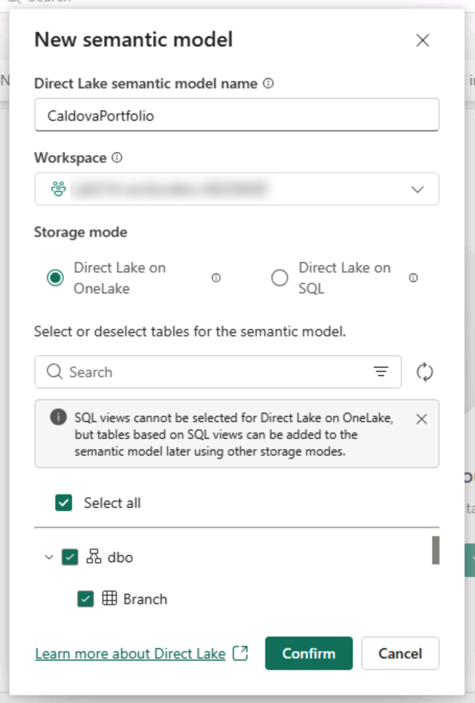
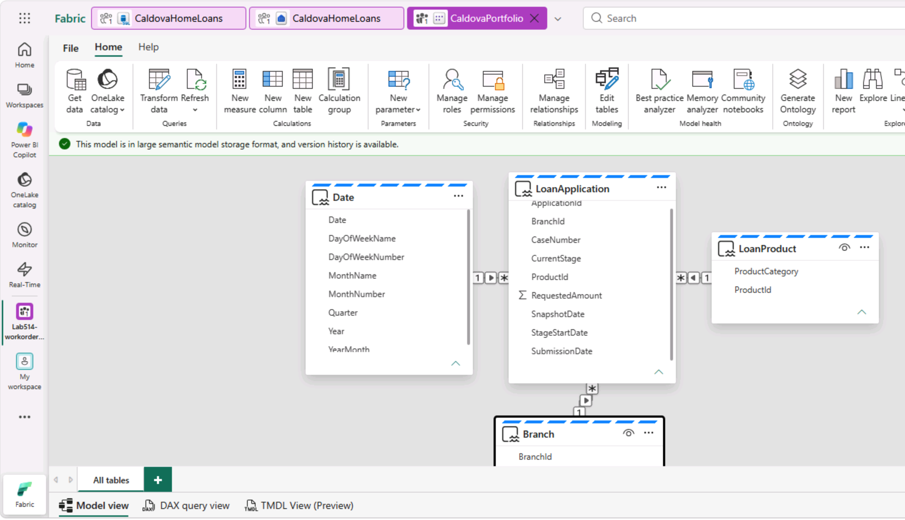
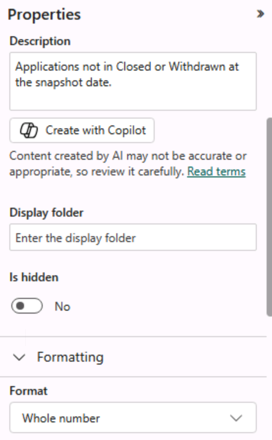
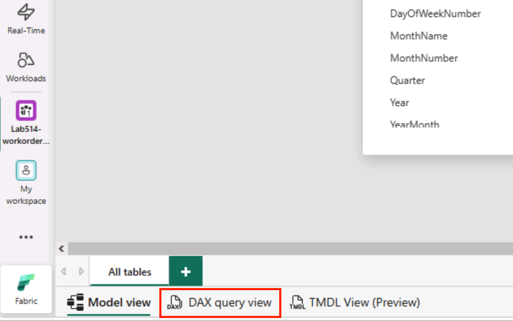

# Exercise 3: Build the portfolio semantic model

A semantic model defines business metrics once, so every report, agent, and app that uses it gets the same numbers. In this exercise, you build a Direct Lake semantic model over the portfolio data, relate its tables, and define the four pipeline measures that the Home Loan Operations Desk app queries in part 2.

By completing this exercise, you will:

- Create a Direct Lake semantic model from the SQL analytics endpoint.
- Relate the branch, product, and date tables to the loan applications.
- Define the four shared pipeline measures, with formats and descriptions.
- Check the measures against the reference values with DAX queries.

## Task 1: Create the semantic model

Create the model directly from the replicated data in OneLake.

1. In Microsoft Edge, return to the **CaldovaHomeLoans** SQL analytics endpoint you opened at the end of Exercise 2.

1. Select **New semantic model** in the toolbar.

1. Name the semantic model +++CaldovaPortfolio+++.

1. Select **Direct Lake on OneLake** as the storage mode.

1. Under **dbo**, select the **Branch**, **Date**, **LoanApplication**, and **LoanProduct** tables, then select **Confirm**.

    

1. Wait for the model to open in the browser. It shows the four tables in the model diagram.

## Task 2: Connect the tables

The portfolio data is a star schema: **Branch**, **LoanProduct**, and **Date** each describe many rows in **LoanApplication**. Relationships let a filter on a branch, product, or date flow to the applications.

1. In the model diagram, drag the **BranchId** column from the **Branch** table onto the **BranchId** column in the **LoanApplication** table.

1. In the **New relationship** dialog, confirm that **Cardinality** is **One to many (1:\*)** and **Cross-filter direction** is **Single**, then select **Save**.

1. Drag the **ProductId** column from the **LoanProduct** table onto the **ProductId** column in the **LoanApplication** table. Confirm the same settings, then select **Save**.

1. Drag the **Date** column from the **Date** table onto the **SubmissionDate** column in the **LoanApplication** table. Confirm the same settings and that the relationship is active, then select **Save**.

    > [!NOTE]
    > The submission date drives date filters. The duration measures you add next use the stage start and snapshot dates stored on each application instead.

1. Confirm that the model diagram shows three relationships, all pointing from a lookup table to **LoanApplication**.

    

    > [!TIP]
    > You can move the tables around in the model diagram to better visualize the relationships.

1. In the **Date** table, select **...** (**More options**), then in the dropdown menu select **Mark as date table**.

1. Turn the **Mark as a date table** toggle on, then select the **Date** column as the date column, then select **Save**.

## Task 3: Define the shared measures

The model, not the app, defines how Caldova Home Loans counts its pipeline. An application is open when it isn't in the Closed or Withdrawn stage, and it's stalled when it has spent more than 7 days in its current stage.

1. In the **Data** pane, select the **LoanApplication** table, then select **New measure** in the top ribbon toolbar.

1. In the formula bar, replace the text with the following DAX, then press **Enter**:

    ```dax
    Open applications =
    COUNTROWS (
        FILTER (
            LoanApplication,
            NOT ( LoanApplication[CurrentStage] IN { "Closed", "Withdrawn" } )
        )
    )
    ```

1. In the **Properties** pane, set **Description** to `Applications not in Closed or Withdrawn at the snapshot date.` Under **Formatting**, check that **Format** is set to **Whole number**.

    

1. Create the **Requested amount in pipeline** measure the same way, on the **LoanApplication** table:

    ```dax
    Requested amount in pipeline =
    SUMX (
        FILTER (
            LoanApplication,
            NOT ( LoanApplication[CurrentStage] IN { "Closed", "Withdrawn" } )
        ),
        LoanApplication[RequestedAmount]
    )
    ```

    Set **Description** to `Requested amounts of open applications. Requested volume, not revenue or a commitment.` Set **Format** to **Currency** in US dollars, with **0** decimal places.

1. Create the **Average days in current stage** measure the same way:

    ```dax
    Average days in current stage =
    AVERAGEX (
        FILTER (
            LoanApplication,
            NOT ( LoanApplication[CurrentStage] IN { "Closed", "Withdrawn" } )
        ),
        DATEDIFF ( LoanApplication[StageStartDate], LoanApplication[SnapshotDate], DAY )
    )
    ```

    Set **Description** to `Average calendar days between stage start and the snapshot date, for open applications.` Set **Format** to **Decimal number**, with **2** decimal places.

1. Create the **Stalled applications** measure the same way:

    ```dax
    Stalled applications =
    COUNTROWS (
        FILTER (
            LoanApplication,
            NOT ( LoanApplication[CurrentStage] IN { "Closed", "Withdrawn" } )
                && DATEDIFF ( LoanApplication[StageStartDate], LoanApplication[SnapshotDate], DAY ) > 7
        )
    )
    ```

    Set **Description** to `Open applications with more than 7 days in their current stage (a fictional operations threshold).` Set **Format** to **Whole number**.

1. Confirm that the four measures appear under the **LoanApplication** table in the **Data** pane.

    > [!TIP]
    > Changes in the browser are saved to the model automatically.

## Task 4: Check the measures

Run DAX queries against the model to confirm that the measures return the reference values for the snapshot date.

1. Select **DAX query view** in the left-hand pane of the model editor.

    

1. Paste the following query into the editor, then select **Run**:

    ```dax
    EVALUATE
    ROW (
        "Open applications", [Open applications],
        "Requested amount in pipeline", [Requested amount in pipeline],
        "Average days in current stage", [Average days in current stage],
        "Stalled applications", [Stalled applications]
    )
    ```

1. Confirm that the results show **172** open applications, **52,776,000** requested in the pipeline, about **5.95** average days in current stage, and **48** stalled applications.

1. Replace the query with the following one, then select **Run**:

    ```dax
    EVALUATE
    SUMMARIZECOLUMNS (
        LoanApplication[CurrentStage],
        "Open applications", [Open applications],
        "Stalled applications", [Stalled applications]
    )
    ORDER BY [Stalled applications] DESC
    ```

1. Confirm that **Document collection** comes first, with **53** open and **31** stalled applications.

    > [!NOTE]
    > Document collection holds 31 of the 48 stalled applications. That's the bottleneck you'll investigate in the app, starting with case HL-1042.

Select **Next →** to continue.
