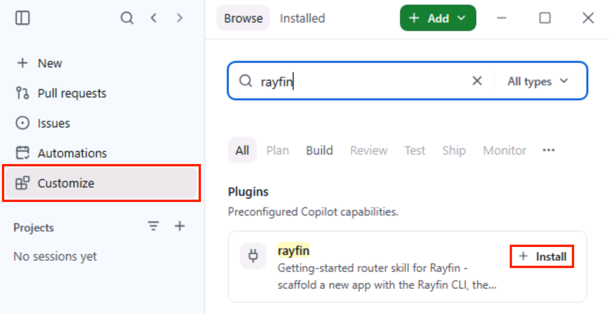
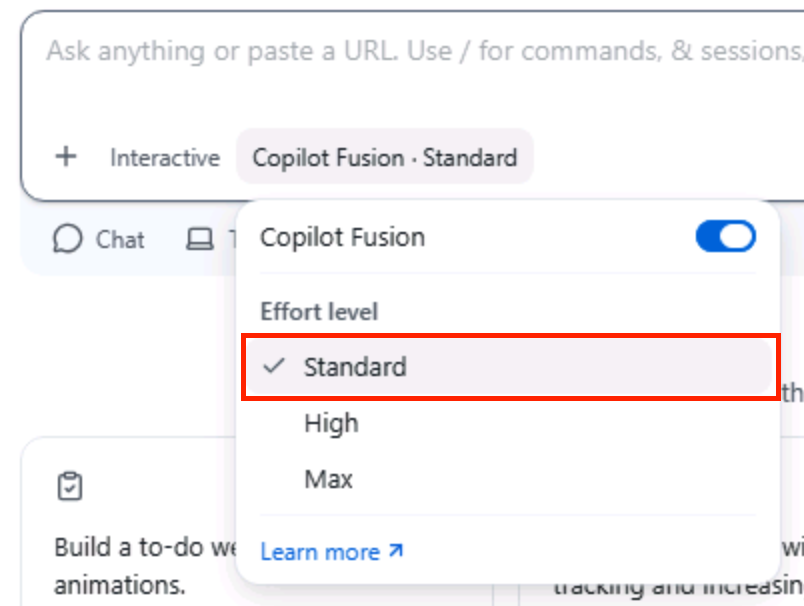
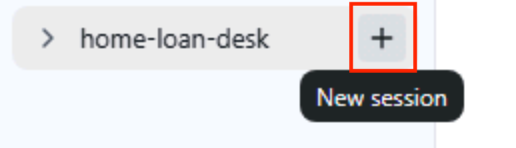
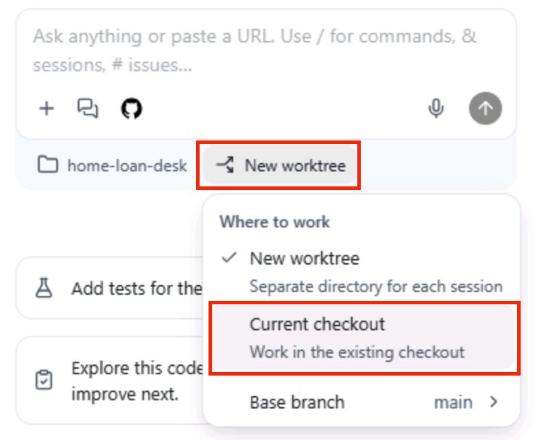
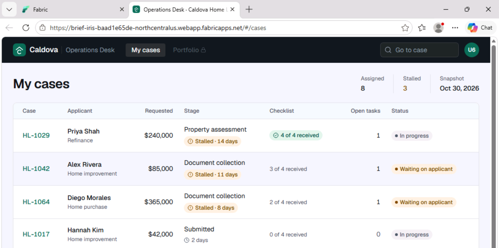

# Exercise 4: Bootstrap and deploy the Home Loan Operations Desk app

With the portfolio data and semantic model in place, it's time to build the app that Caldova Home Loans' loan officers use. In this exercise, you ask the GitHub Copilot app to create the **Home Loan Operations Desk** app from the lab template, then sign in to Rayfin and deploy it to your Microsoft Fabric workspace.

By completing this exercise, you will:

- Install the Rayfin plugin in the GitHub Copilot app.
- Create the app from the lab template and save it to a Git repository.
- Sign in to Rayfin and deploy the app to Microsoft Fabric.
- Open the deployed app and find your lab cases.

## Task 1: Install the Rayfin plugin

The Rayfin plugin adds a getting-started skill that teaches the agent how to create a Rayfin project. Once a project exists, the agent switches to the version-matched Rayfin skills and docs that ship inside the project.

1. In the GitHub Copilot app, select the **Customize** tab in the left panel.

1. In the search bar, enter `rayfin`.

1. In the results, find the **rayfin** plugin from the **awesome-copilot** marketplace, then select **Install**.

    

1. Confirm that the **rayfin** plugin appears in your installed plugins.

> [!IMPORTANT]
> It may take some time before the marketplace fully loads, and sometimes results in an empty list if you search for "rayfin". Please wait a bit and try again.
> If the awesome-copilot marketplace fails to load, try hitting the **refresh** button and wait for it to reload.
> 

## Task 2: Create the app from the lab template

The lab template is a working, secure starter that we'll use to get faster to the more interesting parts of the lab. It includes Fabric sign-in, private case workspaces protected by access rules, and a portfolio page ready to connect to your semantic model. It's available on the virtual machine at **C:\LabFiles\template\home-loan-desk**.

1. In the GitHub Copilot app, start a new chat.

1. Click on the model picker in the chat area (note that the icon may vary) and enable **Copilot Fusion** mode.

    

    > [!TIP]
    > **Copilot Fusion** is an intelligent runtime model router and orchestrator. This mode ensures that the agent uses the appropriate model for the task at hand, improving the accuracy and relevance of its responses, while optimizing the cost. Default effort level is *Standard*, which balances speed, cost, and accuracy. You can also opt for *High* or *Max* effort levels for more demanding tasks that require greater accuracy and thoroughness, at the expense of speed and cost.

1. Enter the following prompt, then press **Enter**:

    ```text
    Create a new Rayfin app named home-loan-desk in my user profile folder, using the lab template at C:\LabFiles\template\home-loan-desk. When it's ready, initialize a Git repository and make an initial commit. Then open the folder as a project in the GitHub Copilot app.
    ```

1. Watch the agent work. It uses the Rayfin plugin to:

    - Create the **home-loan-desk** folder from the lab template.
    - Install the app dependencies. This can take a couple of minutes.
    - Initialize a Git repository and commit the starter code.
    - Add the folder as a project in the GitHub Copilot app.

    > [!NOTE]
    > The initial commit matters: in later exercises, you review each change the agent makes as a clean diff against this starting point.

    > [!TIP]
    > The project bootstrapping may take up to 10-15 minutes as it will install dependencies and set up the project structure. This is a good time to take a short break if needed.

1. When the agent finishes, create a new session in the **home-loan-desk** project that was added to the list.

    

1. Select the **New worktree** button and change it to **Current checkout**.

    

    > [!TIP]
    > By default, GitHub Copilot app creates a new worktree for each session. This allows you to work on multiple features simultaneously without interfering with each other. Since we'll work on a single feature at a time in this lab, working directlty in the current project checkout simplifies the workflow.

## Task 3: Sign in to Rayfin and deploy the app

Deploying creates a Fabric App item in your workspace, provisions a managed SQL database for the app's case records, applies the data schema, and hosts the frontend.

1. In the **home-loan-desk** session, enter the following prompt:

    ```text
    Sign me in to Rayfin interactively, then deploy this app to my Fabric workspace, without running prior checks or dry run.
    Return the deployed app URL when done.
    Workspace URL: <replace with the URL of your Fabric workspace>
    ```

1. Before validating the prompt, open the web browser with the Microsoft Fabric tab, and navigate to your workspace if needed. Copy the URL of your workspace to use in the next step and paste it in the prompt. Press **Enter** to continue.

1. A confirmation dialog will appear at the bottom asking you if you trust the repository. Select **A. Always trust repository** to continue.

1. When a browser window opens to sign in, select the **@lab.CloudPortalCredential(User1).Username** account.

    > [!TIP]
    > If you're asked for credentials, use the same email and Temporary Access Pass you used in Exercise 1.

1. Wait for the deployment to finish. The first deployment takes a few minutes.

    > [!IMPORTANT]
    > Rayfin tool may report an error like **Login failed: OS keychain is not available and plaintext token storage is not enabled.** because of the VM environment. If asked, allow the agent to login using plain text credentials storage and retry.

1. Confirm that the agent reports a successful deployment and gives you the URL of the hosted app.

## Task 4: Open the deployed app

1. In Microsoft Edge, open the hosted app URL from the previous task in a new tab.

1. Select **Sign in**. Since you already have an active sign-in session, you're signed in without entering credentials again.

1. If a Microsoft Fabric dialog asks you to allow the app to use your Microsoft Fabric credentials, select **Accept**.

1. On your first sign-in, the app shows **Preparing data** while it creates your lab cases. Wait for it to finish.

1. Confirm that **My cases** lists your assigned cases, with stalled cases first, including **HL-1042** for Alex Rivera.

    > [!NOTE]
    > All applicants, amounts, and documents are fictional. Case **HL-1103** is assigned to a colleague, so it doesn't appear in your list. You'll come back to it when you test the access rules.



Select **Next →** to continue.
