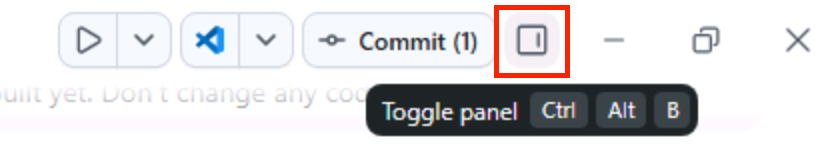
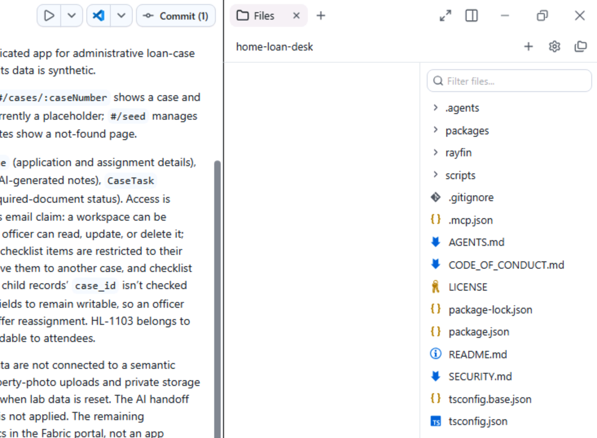

# Exercise 5: Explore the Home Loan Operations Desk app

Before you extend the Home Loan Operations Desk, take a few minutes to get to know it. In this exercise, you ask GitHub Copilot for a tour of the starter code, browse the key files yourself, then use the deployed app to find out why Alex Rivera's application is stuck.

By completing this exercise, you will:

- Get a tour of the app's routes, data, and access rules from GitHub Copilot.
- Browse the project files in the GitHub Copilot app.
- Explore the deployed app and find out why case **HL-1042** is stalled.

## Task 1: Ask Copilot for a tour of the app

The project includes an **AGENTS.md** file that tells the agent what this app is, what's already built, and which rules it must never break. Ask Copilot to use it to explain the app.

1. In the GitHub Copilot app, open a new session in the **home-loan-desk** project.

1. Enter the following prompt, then press **Enter**:

    ```text
    Read AGENTS.md and give me a short tour of this app: routes, data entities and their access rules, and what is not built yet. Don't change any code.
    ```

1. Read the tour. It should cover:

    - **Routes**: **#/cases** (My cases), **#/cases/:caseNumber** (case detail), **#/manager** (portfolio), and **#/seed** (lab data).
    - **Entities**: **CaseWorkspace**, **CaseNote**, **CaseTask**, and **ChecklistItem**, each protected by access rules based on the signed-in officer's email.
    - **Not built yet**: the portfolio analytics page, file uploads for case photos, and the AI handoff brief. You build these in the next exercises.

    > [!NOTE]
    > The agent's wording varies. If something in the tour isn't clear, ask a follow-up question in the same session.

## Task 2: Browse the code in the Files panel

You can read the project files without leaving the GitHub Copilot app, side by side with your chat.

1. In the top-right corner of the GitHub Copilot app, select the **Toggle panel** button.

    

1. In the right panel, select **+** (**Open in panel**), then select **Files**.

    

    > [!TIP]
    > To read the code more comfortably, you can alternatively select **Open in VS Code** in the session header. It opens the **home-loan-desk** project in Visual Studio Code.

1. In the **Files** panel, open **rayfin/rayfin.yml**. This file turns the Rayfin managed services for the app on or off. Notice these services:

    | Service | What it does in this app |
    | --- | --- |
    | **auth** | Signs officers in with their Microsoft Fabric (Microsoft Entra) account. |
    | **data** | Creates a managed SQL database for the app's case records, from the entities in **packages/data**. |
    | **connectors** | Lets the app query external data sources, such as your semantic model. |
    | **staticHosting** | Hosts the built frontend. `assetAccess: protected` means only signed-in users can load the app. |
    | **storage** | Turned off for now. You turn it on to store case photos. |
    | **functions** | Turned off for now. You turn it on for the AI handoff brief. |

1. Open **packages/data/src/CaseWorkspace.ts**. This class defines the table for loan cases. Notice these decorators:

    - **@entity()** creates a database table from the class.
    - **@authenticated(...)** sets an access rule for signed-in users. Each `policy` compares the caller's email claim with a field on the record, such as **assigned_officer_email**.
    - `exclude: ['created_by_email']` prevents anyone from changing who created a case.
    - **@uuid()**, **@text()**, **@set()**, **@date()**, and **@decimal()** define the columns and their allowed values.

    > [!NOTE]
    > These rules are enforced by the Rayfin data API on every request, not by the frontend. A case assigned to another officer can't be read, even by calling the API directly.

1. *(Optional)* Open **packages/frontend/src/pages/** to see the app pages, and **packages/frontend/src/services/cases.ts** to see how the frontend reads and writes case data with the typed Rayfin client.

## Task 3: Explore the deployed app

Now look at the app the way a loan officer at Caldova Home Loans would see it.

1. In the browser, go back to the tab with the deployed Home Loan Operations Desk app from Exercise 4.

1. On **My cases**, look at the summary at the top: how many cases are **Assigned** to you, how many are **Stalled**, and the **Snapshot** date of the data.

1. In the cases table, notice that stalled cases are listed first, with a **Stalled** badge showing how many days they've spent in their current stage.

1. In the header, notice the **Go to case** box to open any case by its number, and the **Portfolio** item, which is disabled until you connect your semantic model in the next exercise.

1. In the cases table, select **HL-1042** to open Alex Rivera's case.

1. At the top of the case page, check the **Stage** and **Time in stage**. The application has spent 11 days in **Document collection**.

1. In the **Document checklist** panel, find the item that's still **Outstanding**: **Renovation plans / current-state photos**. It's marked **Upload only** because the app can't receive files yet. We'll fix this in a later exercise.

1. In the **Case notes** panel, read the notes from oldest to newest. Notice that they contradict each other:

    - One note says Alex Rivera emailed the floor plan and kitchen photos to the branch inbox.
    - A later note says that nothing arrived in the branch inbox or the case file.

    This is why the case is stalled: the bank is waiting on documents the applicant believes they already sent.

1. In the **Handoff brief** panel, notice that **Generate handoff brief** is disabled. You build this AI feature in a later exercise, and it will flag this kind of contradiction for you.

Select **Next →** to connect your semantic model and add portfolio analytics to the app.
