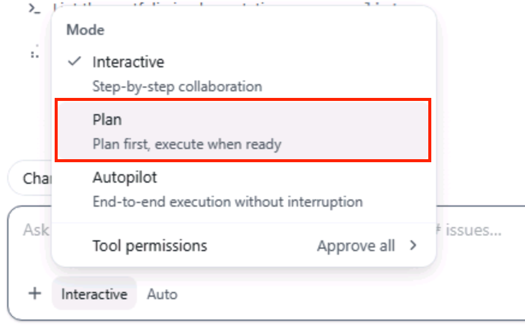
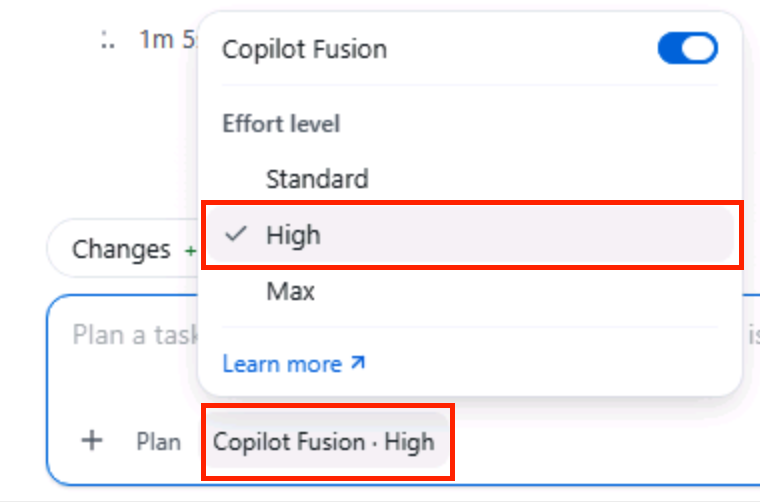

# Exercise 6: Add portfolio analytics from the semantic model

In Exercise 3, you defined four pipeline measures once, in the **CaldovaPortfolio** semantic model. In this exercise, you connect the Home Loan Operations Desk app to that model, so the portfolio page shows the same numbers as every other report, and helps officers spot where applications stall.

By completing this exercise, you will:

- Connect your semantic model to the app with the Rayfin semantic model connector.
- Build the portfolio page with the four shared measures, filters, a stage distribution, and a stalled list.
- Redeploy the app and check the values against the semantic model.

## Task 1: Copy your semantic model URL

The connector needs your workspace ID and the semantic model ID. Both are in the semantic model's URL.

1. In Microsoft Edge, open the Microsoft Fabric tab, then go to your **PREL40-homeloans-@lab.LabInstance.Id** workspace.

1. In the workspace item list, select **CaldovaPortfolio**, with the type **Semantic model**, to open its details page.

1. Keep the tab open, we'll need it to copy the URL in the next task.

    > [!TIP]
    > You can also give Copilot your workspace URL and the model name, `CaldovaPortfolio`. The agent then finds the IDs with the `rayfin connector search` command.

## Task 2: Connect the semantic model

Ask Copilot to add the connector and read the model's metadata before it writes any query.

1. In the GitHub Copilot app, open a new session in the **home-loan-desk** project, and make sure it uses **Current checkout**.

1. Enter the following prompt, replace the placeholder with the URL you copied, then press **Enter**:

    ```text
    Connect my CaldovaPortfolio semantic model to this app with the Rayfin semantic model connector.
    Then inspect the model metadata and list its tables, relationships, and measures. Don't change the app pages yet.
    Semantic model URL: <replace with your semantic model URL>
    ```

1. Go back to your Fabric tab with the semantic model open, copy the URL from the address bar and paste it into the prompt. Press **Enter** to continue.

1. Read the agent's summary. It should report:

    - A new connector of type `fabric-semanticmodel` in **rayfin/rayfin.yml**, with `delegated` authentication.
    - A typed schema for the connector in **rayfin/connectors/**.
    - The **Branch**, **Date**, **LoanApplication**, and **LoanProduct** tables, and the four measures you created in Exercise 3: **Open applications**, **Requested amount in pipeline**, **Average days in current stage**, and **Stalled applications**.

    > [!INFO]
    > With delegated authentication, the app queries the model as the signed-in user. Only people with access to the semantic model can see the portfolio, whatever the app allows.

## Task 3: Build the portfolio page

The **Portfolio** page already has empty measure cards and placeholders, waiting for a connected model. We'll now ask Copilot to populate them with live data from the semantic model.

1. In the same session, click on **Interactive** (mode) from the chat area to switch to **Plan** mode. Since this steps involves multiples changes to the app, Plan mode helps you review and approve them before they are applied.

    

1. This is a more demanding task, so let's also set the Copilot Fusion effort level to **High** to ensure best results.

    

1. Enter the following prompt, then press **Enter**:

    ```text
    Build the operations portfolio from the connected semantic model, and enable it in the navigation:
    - All measures from the semantic model
    - Add branch and product filters that apply to every query.
    - Show the distribution of open and stalled applications by stage as a chart.
    - List stalled applications with case number, branch, product, stage, and days in stage. Tag the cases I can see in My cases as "Assigned to you" with a link to the case, and show the others as "Not assigned to you" without a link.
    - Show the snapshot as-of date.
    Ensures measures come from the semantic model and are not calculated in JavaScript.
    ```

1. Once the plan is generated, you should be able to review the proposed changes and see the task list in the *Plan* canvas on the right panel. Review the changes, and select **Approve plan and continue** to start the implementation.

    > [!INFO]
    > When you approve the plan, Copilot will automatically switch to **Autopilot** mode to implement the changes. In this mode, it will never ask you questions and will carry out the tasks as specified until the work is complete. 

1. Wait for the agent to finish, this can take several minutes.

1. In the **Files** panel, open **packages/frontend/src/pages/manager-page.tsx** and the files it imports. Notice that the DAX queries reference the measures by name, such as `[Open applications]`, instead of recalculating them.

    > [!INFO]
    > Defining measures once in the model is the point: the app, your Power BI reports, and any data agent all get the same numbers.

## Task 4: Redeploy and check the portfolio

1. In the same session, enter the following prompt, then press **Enter**:

    ```text
    Redeploy this app to the same Fabric workspace, without running prior checks or dry run. Return the deployed app URL when done.
    ```

1. Wait for the agent to report a successful deployment.

    > [!NOTE]
    > Redeploying to the same app keeps its data, so your lab cases are still there.

1. In Microsoft Edge, go back to the tab with the deployed app, then reload the page.

1. In the header, select **Portfolio**, which is now enabled.

1. Confirm that the measures match the reference values from Exercise 3:

    | Measure                           | Value          |
    | --------------------------------- | -------------- |
    | **Open applications**             | 172            |
    | **Requested amount in pipeline**  | USD 52,776,000 |
    | **Average days in current stage** | 5.95           |
    | **Stalled applications**          | 48             |

    The page also shows the snapshot date of the portfolio data: October 30, 2026.

    > [!TIP]
    > If a panel shows an error, paste the error message in the same session and ask Copilot to fix it. Never accept mock or sample values as a fix.

1. In the stage distribution, notice that **Document collection** stands out: it holds 31 of the 48 stalled applications.

1. Select a branch in the branch filter, such as **Seattle Downtown**. Confirm that the measures, the chart, and the stalled list all update. Then clear the filter.

1. In the stalled list, find **HL-1042**. It's tagged **Assigned to you**.

1. Find **HL-1103**. It's tagged **Not assigned to you**, without a link: the case is in the shared portfolio, but it belongs to your colleague Morgan Lee. You test that boundary in the next exercise.

1. Select **HL-1042** to open Alex Rivera's case from the portfolio.

Select **Next →** to continue.
