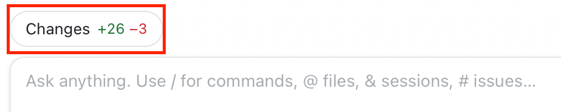

# Exercise 7: Add property photos with Rayfin storage

HL-1042 is stalled in Document collection because the bank never received Alex Rivera's renovation plans and current-state photos. In this exercise, you add private file storage to the Home Loan Operations Desk app, so officers can upload a case's documents and keep them with the case, protected by the same kind of access rule as the case data.

By completing this exercise, you will:

- Turn on Rayfin storage and declare a private folder for case files, with an access rule scoped to the signed-in officer.
- Add upload, list, and download to the case page, and mark the checklist item received after a successful upload.
- Redeploy the app and upload HL-1042's floor plan and kitchen photo.
- Commit your changes to the Git repository.

## Task 1: Add a private storage folder

Rayfin storage keeps files in OneLake, in folders that you declare in code. Like entities, each folder has access rules that the service checks on every request. Start with the folder and its rule, before any UI.

1. In the GitHub Copilot app, open a new session in the **home-loan-desk** project, and make sure it uses **Current checkout**.

1. Enter the following prompt, then press **Enter**:

    ```text
    Use Rayfin storage to add a private case-photos storage folder:
    - Allowed file types: JPEG, PNG, and PDF, up to 5 MB.
    - Typed fields: case_id, officer_email, and category.
    - Access rule: files can be read, uploaded, and deleted only when officer_email is my email.
    Don't change the app pages yet. Summarize the folder and its access rule.
    ```

1. Read the agent's summary. It should report:

    - Storage enabled with `services.storage.enabled: true` in **rayfin/rayfin.yml**.
    - A new folder class for `case-photos` in **rayfin/storage/**, registered in the storage schema.
    - The `@microsoft/rayfin-storage` package, at the same version as the other Rayfin packages.

1. Select the **Changes** button just above the chat input area to quickly see the files that were modified by the agent.

    

1. Find the folder file in **rayfin/storage/**, and look for the access rule. Its policy compares the caller's email claim with the file's field: `claims.email.eq(item.officer_email)`.

    This is the same rule shape as the case entities you explored in Exercise 5: the storage service checks it on every upload, list, download, and delete, whatever the frontend does.

## Task 2: Add uploads to the case page

The **Document checklist** on the case page marks **Renovation plans / current-state photos** as **Upload only**, waiting for storage. Now ask Copilot to add the upload experience.

1. In the same session, switch to **Plan** mode, and set the Copilot Fusion effort level to **High**, like in Exercise 6.

1. Enter the following prompt, then press **Enter**:

    ```text
    Add property files to the case detail page, using the case-photos storage folder:
    - Upload JPEG, PNG, or PDF files for the case, stamped with the case ID, my email from the session, and the renovation-plans-photos category. Store each case's files under its own prefix.
    - List the case's files, with an authorized download for each file.
    - Mark the "Renovation plans / current-state photos" checklist item as received by upload, only after a successful upload.
    - If an upload, list, or download fails, show the real error. Never fall back to browser storage or sample files.
    - When I reset my lab cases, also delete my uploaded files.
    ```

1. Once the plan is generated, review the proposed changes and the task list in the *Plan* canvas, then select **Approve plan and continue**.

1. Wait for the agent to finish, this can take several minutes.

    > [!INFO]
    > The prefix only organizes the files by case. The folder's access rule is what protects them: another officer can't list or download your files, even with the right prefix.

## Task 3: Redeploy and upload HL-1042's files

The storage folder is created in Fabric when you deploy, so redeploy the app before you test the uploads.

1. In the same session, enter the following prompt, then press **Enter**:

    ```text
    Redeploy this app to the same Fabric workspace, without running prior checks or dry run. Return the deployed app URL when done.
    ```

1. Wait for the agent to report a successful deployment.

1. In the browser, go back to the tab with the deployed app, then reload the page.

1. Open **HL-1042**, from **My cases** or with the **Go to case** box.

1. In the **Document checklist** panel, confirm that **Renovation plans / current-state photos** is still **Outstanding**.

1. In the new files panel, select the button to add a file. In the file dialog, enter `C:\LabFiles\data\samples\HL-1042-floor-plan.pdf` in the file picker, then select **Open**. Select the **Upload** button to confirm.

    > [!TIP]
    > Your generated UI may have a different layout or wording, so adjust the steps accordingly.

1. Confirm that **HL-1042-floor-plan.pdf** appears in the list of the case's files, and that **Renovation plans / current-state photos** is now **Received**, with today's date, marked as uploaded.

    > [!TIP]
    > If the upload shows an error, paste the error message in the same session and ask Copilot to fix it. Never accept a fix that stores files in the browser or shows sample files.

1. Upload the current-state photo the same way: `C:\LabFiles\data\samples\HL-1042-kitchen-current.jpg`.

1. Select **HL-1042-floor-plan.pdf** in the list to download it, and confirm that it opens: it's the ground floor plan of the Rivera residence, with the renovated kitchen and the proposed rear extension.

1. Reload the page. Confirm that both files are still listed, and that the checklist item is still **Received**.

1. In the Task panel, you can tick the follow up task to mark it as completed. The case is almost ready for review.

## Task 4: Commit your changes

Save your work in Git, so the next exercise starts from a clean diff.

1. Click on the **Commit** button at the top of the session area.

1. Wait for the agent to confirm the commit.

Select **Next →** to continue.
