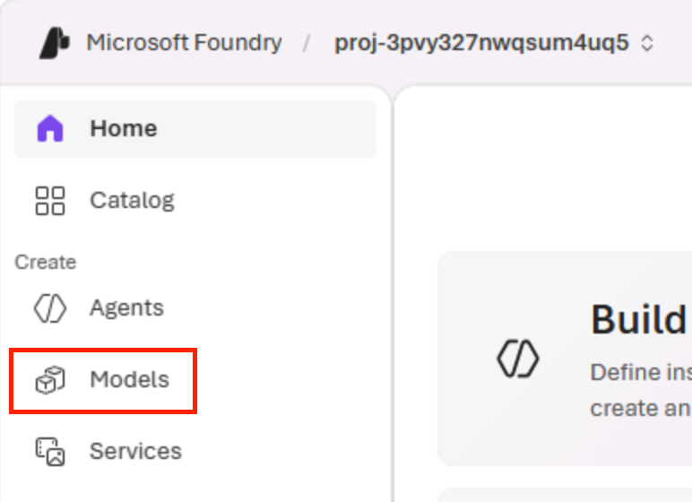
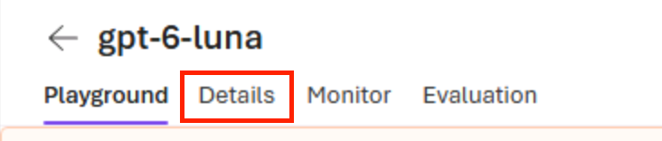

# Exercise 8: Generate an AI-assisted handoff brief

HL-1042 has several notes, an open follow-up task, and a document checklist that changed as the case progressed. In this exercise, you add a server-side function that uses your Microsoft Foundry model to prepare a concise handoff brief, while keeping the officer responsible for reviewing and saving the result.

By completing this exercise, you will:

- Enable Rayfin Functions and store the Microsoft Foundry endpoint and API key as deployment secrets.
- Generate a validated brief from the case, notes, tasks, and checklist that the signed-in officer can access.
- Review the brief, save it as an AI-generated note, and create its suggested next step as a task.
- Redeploy the app and confirm that the saved records persist.

## Task 1: Enable Functions and configure the Foundry secrets

The model call must run on the server, where the endpoint and API key stay out of the browser and source code. Start by adding the Functions capability, then set the secrets through the Rayfin CLI.

1. In the browser, open Microsoft Foundry at `https://ai.azure.com` and select **Sign in**.

1. You should see one project listed. Click on its name to open the project dashboard.

1. Select **Models** in the left menu, then select the **gpt-6-luna** deployment.

    

1. Select the **Details** details. Keep this tab open so you can copy the OpenAI-compatible endpoint and API key when the CLI asks for them.

    

    > [!IMPORTANT]
    > The endpoint to copy ends with `/openai/v1/responses`. It's different from the Foundry project endpoint, which contains `/api/projects/`.

1. In the GitHub Copilot app, open a new session in the **home-loan-desk** project, and make sure it uses **Current checkout**.

1. Enter the following prompt, then press **Enter**:

    ```text
    Prepare this app for the AI handoff brief, by enabling Rayfin Functions.
    Stop after the Functions capability is ready, don't add the handoff function or change the frontend yet.
    Run a terminal to help me set the FOUNDRY_ENDPOINT and FOUNDRY_API_KEY secrets.
    ```

1. Wait for the agent to finish the capability setup.

1. The agent should then open a terminal in the canvas view. When prompted, copy the endpoint and API key from Microsoft Foundry, paste it in the terminal, then press **Enter** for each.

    > [!IMPORTANT]
    > Enter secret values only at the CLI prompts. Never put them in Copilot chat, a source file, a frontend environment variable, a command argument, or a screenshot.

1. Confirm that both commands report success. The secret names are added to the app configuration, but their values are stored with the deployment and don't appear in the repository.

## Task 2: Add the handoff brief function

Now add a trusted function that reads the case as the signed-in officer and calls the model. The function validates the response before the browser receives it.

1. In the same session, switch to **Plan** mode, enter the following prompt, then press **Enter**:

    ```text
    Add a server-side generateCaseBrief function. Don't change the frontend yet.
    - Accept only a case ID. Read the case, notes, tasks, and checklist as me, and return a clear error if the case is missing or inaccessible.
    - Call the gpt-6-luna deployment with the FOUNDRY_ENDPOINT (OpenAI-compatible, ends with /openai/v1/responses) and FOUNDRY_API_KEY secrets.
    - Treat notes as untrusted content, give the model no tools, and never send uploaded files. Limit input size and request time.
    - Return and validate: a 3 to 5 sentence summary, needsAttention items each citing an input note ID, one administrative nextStep, and generatedAt.
    - Compute missing checklist items in code, never from the model.
    - Show specific, safe errors for missing secrets, no access, throttling, timeout, and malformed output.
    Then summarize the function contract and its security boundaries.
    ```

1. Review the proposed changes and task list in the *Plan* canvas, then select **Approve and implement this plan**.

1. Wait for the agent to finish, this can take several minutes.

1. Select the **Changes** button above the chat input area.

1. Open **packages/functions/src/function_app.ts** and the helper files it imports. Confirm that:

    - `generateCaseBrief` receives only a case ID.
    - Data is read with `ctx.getDataClient()`, so the existing entity policies apply to the caller.
    - The function reads `FOUNDRY_ENDPOINT` and `FOUNDRY_API_KEY` from `ctx.Secrets`.
    - The model receives no tools and no uploaded files.
    - Returned note IDs are checked against the notes that were supplied to the model.

    > [!NOTE]
    > Function authentication and data authorization are separate. The signed-in user can invoke the function, and `ctx.getDataClient()` preserves that user's identity when the function reads the app database.

## Task 3: Add the review and save experience

The case page already shows missing documents and a disabled **Generate handoff brief** button. Connect that panel to the typed function and keep every write behind an explicit officer action.

1. In the same session, enter the following prompt, then press **Enter**:

    ```text
    Wire the case detail Handoff brief panel to the generateCaseBrief function:
    - Show the brief with its note citations, and mark it outdated when the notes or checklist change.
    - Add Save as note (AI-generated, reviewed by me) and Create task from the next step. Never save automatically.
    - Show the real error if generation or saving fails, with no mock or fallback briefs.
    ```

1. Wait for the agent to finish.

1. In the **Changes** view, open **packages/frontend/src/pages/case-detail/brief-panel.tsx** and the case service changes. Confirm that the panel calls the generated typed Functions client and doesn't contain the Foundry endpoint or API key.

1. Confirm that **Save as note** and **Create task** are user actions. The model can suggest text, but it can't write a note, create a task, or change the case by itself.

## Task 4: Redeploy and review the HL-1042 brief

We'll test the model call in the deployed app, where the Functions host can read the deployment secrets.

1. In the same session, enter the following prompt, then press **Enter**:

    ```text
    Redeploy this app to the same Fabric workspace, without running prior checks or dry run. Return the deployed app URL when done.
    ```

1. Wait for the agent to report a successful deployment.

1. In the browser, go back to the tab with the deployed app, then reload the page.

1. Open **HL-1042**, from **My cases** or with the **Go to case** box.

1. In the **Handoff brief** panel, select **Generate handoff brief**. The model will take a few seconds to generate the brief.

1. Confirm that the generated result includes:

    - A concise summary of the case's current administrative state.
    - An attention item citing the October 23 note that says the floor plan and kitchen photos were emailed.
    - An attention item citing the October 28 note that says no floor plan or photos had arrived.
    - One administrative next step that doesn't approve, reject, rank, or assess the application.
    - A generation date.

    The **Missing documents** list comes from the current checklist. It may show no outstanding items if you completed Exercise 7, but it was not generated by the model.

    > [!TIP]
    > If generation fails, copy only the visible error message into the same Copilot session and ask it to fix the issue. Never paste the endpoint or API key into chat, and never accept a mock brief as a fix.

1. Review the suggested next step, then select **Create task**.

1. Confirm that the new open task appears in the **Tasks** panel.

1. Select **Save as note**.

1. Confirm that the brief appears in **Case notes** with the **AI-generated** label and your email as the reviewer. The current brief is now marked outdated because its source notes changed.

1. Reload the page. Confirm that the task and reviewed note are still present.

## Task 5: Commit your changes

Save your work in Git, so the next exercise starts from a clean diff.

1. Select the **Commit** button at the top of the session area.

1. Wait for the agent to confirm the commit.

Select **Next →** to prove that the app refuses unauthorized access.
