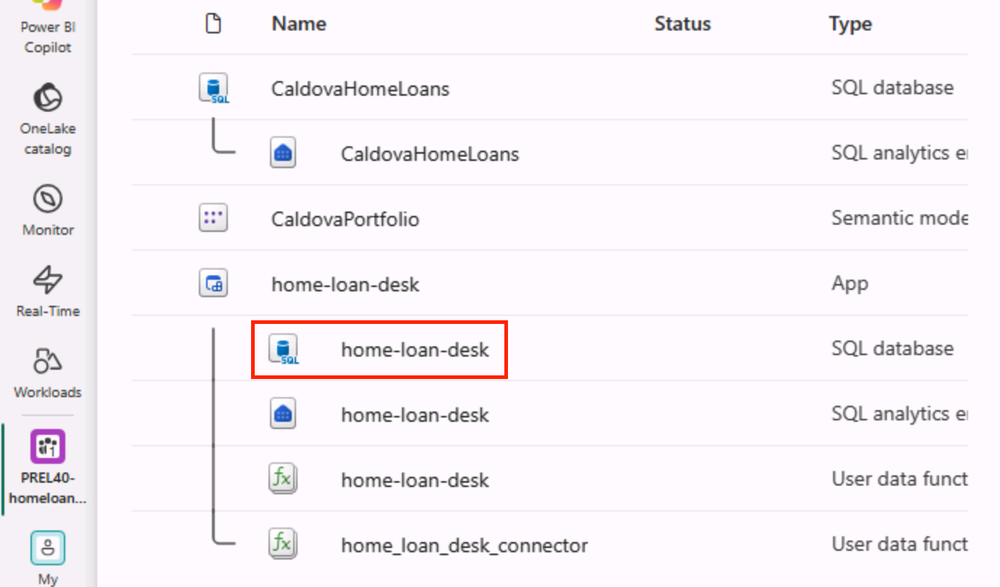
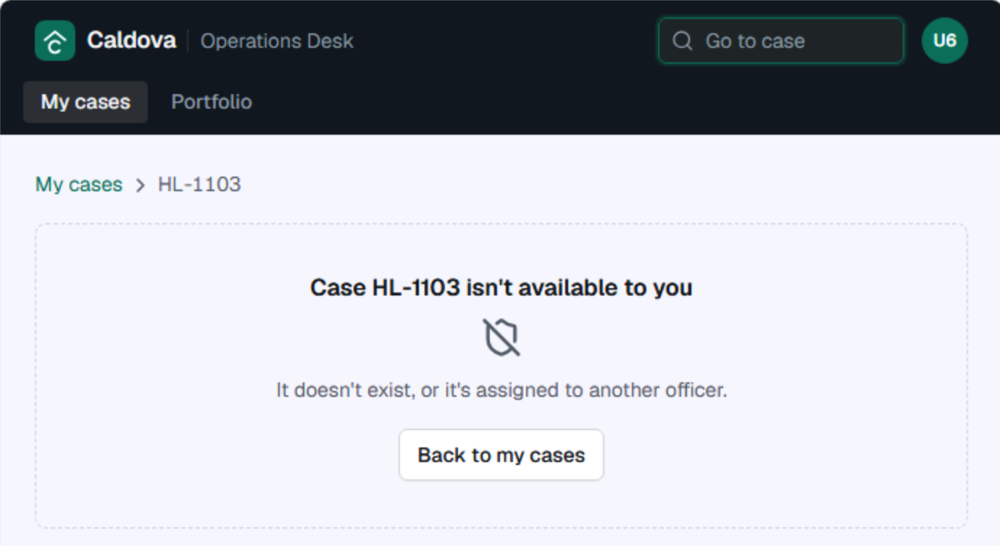

# Exercise 9: Prove that the app refuses unauthorized access

The Home Loan Operations Desk app holds private case notes, documents, and AI-generated briefs. The starter was secure from the start, and every feature you added kept the same access rules. In this exercise, you check that the app refuses access it should refuse, and you see which layer does the refusing each time.

By completing this exercise, you will:

- Get a tour of the app's security layers and access rules from GitHub Copilot.
- Confirm that the data API and the hosted app refuse requests without a signed-in user.
- Find case **HL-1103** in the app's database, then confirm that you can't open it in the app.
- Understand why you can't save a record or upload a file in a colleague's name.

You don't change any code in this exercise.

## Task 1: Get a tour of the security layers

The app is protected by several layers, each with its own job. Ask Copilot to map them before you test them.

1. In the GitHub Copilot app, open a new session in the **home-loan-desk** project, and make sure it uses **Current checkout**.

1. Enter the following prompt, then press **Enter**:

    ```text
    Explain how this app controls access, without changing any code:
    - The layers involved: Fabric item permission, static hosting, entity access rules, the case-photos storage folder, the generateCaseBrief function, and the semantic model connector.
    - For each entity and the storage folder, the exact rule, and the file that defines it.
    Keep it short, as a table.
    ```

1. Study the agent's answer. It should describe these layers:

    | Layer | What it controls |
    | --- | --- |
    | **Fabric item permission** | Who can run the app at all. |
    | **Protected static hosting** | Who can load the frontend. `assetAccess: protected` requires a signed-in user. |
    | **Entity access rules** | Which case records each officer can read and write, checked by the data API on every request. |
    | **Storage folder rule** | Which files each officer can upload, list, download, and delete. |
    | **Function data client** | The handoff brief reads data as the signed-in officer, so the entity rules still apply. |
    | **Semantic model permissions** | Who can query the portfolio. The connector runs queries as the signed-in user. |

1. Notice that every entity rule and the **case-photos** folder rule compare the caller's email claim with a field of the stored record, such as `claims.email.eq(item.officer_email)`.

## Task 2: Try the app without signing in

The data API and the hosted frontend should both refuse anyone who isn't signed in.

1. In the same session, enter the following prompt, then press **Enter**:

    ```text
    Without signing in, send a GraphQL request that lists cases to this app's data API, then request the hosted app URL.
    Use only the public values in the project configuration like the publishable key, never my session or a token, and don't change any code.
    Show me the HTTP status and the error for each request, and tell me which layer refused it.
    ```

1. Confirm that both requests are refused:

    - The data API returns an authorization error, such as `AUTH_NOT_AUTHORIZED`, and no case data.
    - The hosted app URL returns **401** with a sign-in page, instead of the app's files.

    > [!NOTE]
    > The publishable key in the project configuration only identifies the app. It isn't a credential, so it doesn't give access to any data.

    > [!TIP]
    > If your Fabric administrator has enabled anonymous access, the graphql API may return an HTTP status 200 while still refusing to return any case data due to lack of authorization.

1. In the browser, go to the tab with the deployed app, and copy its URL from the address bar.

1. Open a private browser window, paste the app URL in the address bar, then press **Enter**.

1. Confirm that the app asks you to sign in, and doesn't show any case data. The web app itself isn't accessible and requires a Fabric sign-in.

1. Close the private window.

## Task 3: Find HL-1103 in the app's database

Case **HL-1103** is assigned to your colleague Morgan Lee. The lab seeded it with the other cases, so it exists in the app's database, even though it's never shown in your app.

1. In the browser, open the Microsoft Fabric tab, then go to your **PREL40-homeloans-@lab.LabInstance.Id** workspace.

1. In the workspace item list, find the **home-loan-desk** app, then under it select its **SQL database** child item.

    

    > [!NOTE]
    > The app's database is managed by Rayfin, and is read-only in the portal. Its schema only changes when you deploy the app.

1. In the database **Explorer**, expand **home-loan-desk**, **dbo**, then **Tables**, and select the **CaseWorkspace** table to preview its rows.

1. Find the row where **case_number** is **HL-1103**. Notice that its **assigned_officer_email** is `morgan.lee@caldova.example`, not your email.

    As the workspace owner, you manage the platform: you can see every row in the app's database. That doesn't make you an authorized user of the app's data.

## Task 4: Try to open HL-1103 in the app

Now try to reach the same case as a loan officer, through the app.

1. In the browser, go back to the tab with the deployed app.

1. In the header, enter `HL-1103` in the **Go to case** box, then press **Enter**.

1. Confirm that the app shows **Case HL-1103 isn't available to you**. The data API checked the stored **assigned_officer_email** against your email, and returned no record.

    

1. Select **Portfolio** in the header. In the stalled list, find **HL-1103**, and confirm that it's not tagged **Assigned to you**, and without a link.

    The portfolio shows HL-1103 because it's shared, pseudonymous analytics data from your semantic model. The case workspace, with its notes, tasks, and files, stays private to Morgan.

## Task 5: Understand why you can't act in a colleague's name

The access rules check the record being written, not only the record being read. Ask Copilot what stops you from creating records in Morgan's name.

1. In the same Copilot session, enter the following prompt, then press **Enter**:

    ```text
    If I tried to save a note on HL-1042 with officer_email set to morgan.lee@caldova.example, or to upload a file to case-photos with Morgan's email, what would happen?
    Show me the exact rules that would refuse each one, and explain why the frontend isn't what protects the data. Don't change any code.
    ```

1. Read the agent's answer. It should explain that:

    - The **CaseNote** create rule only accepts a note whose **officer_email** is your email, so a note stamped with Morgan's email is refused.
    - The **case-photos** folder rule does the same for uploads, so a file stamped with Morgan's email is refused.
    - The data API and the storage service check these rules on every request. Calling the API directly, without the app's frontend, doesn't get around them.

    > [!TIP]
    > Access rules have limits. A rule checks one record at a time, so it can't confirm that a note's case belongs to you. And because the fields a rule reads must stay writable, an officer could hand their own record to someone else. In production, you'd create child records through a server function that checks case ownership first. We'll come back to this in the conclusion.

Select **Next →** to review your app's metrics in Microsoft Fabric.
