<!-- export-self-guided: source=8c5d8e70d1fa07ad55e32eadafc9fc283ba9ad11 -->

# Build data-rich apps in Microsoft Fabric

<div class="info" data-title="About this workshop">

> This workshop is the self-guided version of the Microsoft Ignite 2026 lab PREL40, **Build data-rich apps in Microsoft Fabric**, using your own GitHub Copilot, Microsoft Fabric, and Microsoft Foundry resources. The steps use the GitHub Copilot app. If you use Visual Studio Code instead, including in GitHub Codespaces, map each GitHub Copilot app step with the [setup guide](https://github.com/microsoft/ignite26-PREL40/blob/main/docs/setup.md#use-visual-studio-code-instead-of-the-github-copilot-app).

</div>

## Lab overview

This lab demonstrates how to build a data-rich internal application with Microsoft Fabric, the Rayfin SDK, and the GitHub Copilot app. You'll combine consistent portfolio metrics from a Fabric semantic model with secure operational data and application behavior managed by Rayfin.

The scenario centers on **Caldova Home Loans**. Its operations staff can see the loan application backlog, but they still move between reports, shared folders, and case notes to understand why an application is stalled and what administrative work should happen next. You'll grow a secure starter into **Home Loan Operations Desk**, an app that helps a loan officer:

- Review shared portfolio metrics and identify stalled applications
- Work with private case notes, tasks, and document checklists
- Upload property photos and plans to protected storage
- Generate an AI-assisted handoff brief from authorized case information
- Save a human-reviewed administrative task to move a case forward

Through the exercises, you'll:

- Create and populate a Fabric SQL database, then build a Direct Lake semantic model with shared pipeline measures
- Deploy and extend a Rayfin app with authentication, protected hosting, a managed SQL database, and private file storage
- Connect the app to the semantic model to explore the portfolio and find cases that need attention
- Prove that Rayfin access policies protect case records and files from unauthenticated or unauthorized access
- Use a server function, secrets, and a model in Microsoft Foundry to create a validated handoff brief
- Review the deployed app's operational metrics in Microsoft Fabric

You'll walk in the shoes of a loan officer at Caldova Home Loans who is responsible for keeping applications moving. You'll use portfolio insights to find stalled cases, secure case tools to gather missing information, and an AI-assisted handoff brief to prepare the next administrative action for human review.

Complete the exercises in order because each one builds on the app, data model, deployment, and resources created in the previous exercises.

## Prerequisites

To complete this workshop, you need:

- A GitHub account with GitHub Copilot.
- A Microsoft Fabric capacity, F2 or larger, or a Fabric trial, with **Fabric Apps (preview)** enabled in your tenant. See [Microsoft Fabric](https://github.com/microsoft/ignite26-PREL40/blob/main/docs/setup.md#microsoft-fabric) in the setup guide.
- An Azure subscription, to deploy a model in Microsoft Foundry.
- GitHub Codespaces, or your own machine.

To learn more about each one, see [Use your own resources](https://github.com/microsoft/ignite26-PREL40/blob/main/docs/setup.md#use-your-own-resources) in the setup guide. Running this workshop with your own resources may incur costs on your Fabric capacity and Azure subscription: when you're done, clean up the resources you created, as explained at the end of the workshop.

In the next section, you'll set up your environment.

---

# Exercise 1: Set up your environment

Before you can build, deploy, and explore the Home Loan Operations Desk app, you need to get your environment ready by preparing your tools and lab files, signing in to GitHub Copilot and Microsoft Fabric, and deploying your model in Microsoft Foundry.

## Task 1: Prepare your environment

This workshop runs in GitHub Codespaces or on your own machine. The setup guide gets you the tools the lab needs, such as Node.js 24 and npm, and creates a lab folder with the files you use in the exercises.

1. Follow the setup guide to [set up GitHub Codespaces](https://github.com/microsoft/ignite26-PREL40/blob/main/docs/setup.md#set-up-github-codespaces) or [set up your own machine](https://github.com/microsoft/ignite26-PREL40/blob/main/docs/setup.md#set-up-your-own-machine). You check your setup at the end of this exercise.

1. When the setup finishes, note the full path of your lab folder that it prints.

    <div class="info" data-title="Note">

    > In this workshop, `<lab-folder>` stands for the full path of the **.workspace** folder in the repository, printed by the setup: `/workspaces/ignite26-PREL40/.workspace` in GitHub Codespaces. Whenever a step or a prompt shows `<lab-folder>`, replace it with this full path. Prompts need the full path, because a new chat doesn't start in the repository.

    </div>

1. Set up [agent tool approvals](https://github.com/microsoft/ignite26-PREL40/blob/main/docs/setup.md#agent-tool-approvals). The steps of this workshop assume that the agent runs its tools without asking for approval, so the long tasks don't stop.

## Task 2: Sign in to the GitHub Copilot app

1. Open the **GitHub Copilot app**.

1. In the GitHub Copilot app, select **Sign in to GitHub**. This will copy the device code to your clipboard and open a browser window for authentication.

1. If prompted with a dialog asking for permission to access your GitHub account, select **Authorize GitHub** to continue.

1. In the browser window that opens, sign in with your own GitHub account that has GitHub Copilot if asked, then paste your device code when prompted with **Ctrl+V** (**Cmd+V** on macOS) and press **Enter**.

1. Return to the GitHub Copilot app. When asked to start with a local folder or a repository, select **Continue** and confirm that it is ready for you to start a conversation.

## Task 3: Create a workspace in Microsoft Fabric

This lab creates the portfolio database, the semantic model, and the Home Loan Operations Desk app in a Microsoft Fabric workspace.

A workspace is a container for all the Fabric items related to your project, such as databases, semantic models, and deployed apps.

1. In a new tab on the browser, navigate to the Microsoft Fabric portal at: `https://app.fabric.microsoft.com`.

1. If you're prompted to sign in, use your Microsoft Fabric account.

1. After a successful sign-in, you will land on the Microsoft Fabric homepage.

    <div class="important" data-title="Important">

    > If the page title and icon in the bottom left corner of the page say "Power BI", you need to switch to the Fabric portal. Select the **Power BI** icon in the bottom left corner, then select **Fabric** to switch to the Microsoft Fabric portal.

    </div>

1. In the Fabric portal, select **Workspaces** from the left-hand navigation pane. Then select **+ New workspace**.

1. Name the workspace `PREL40-homeloans-<your-alias>`, where `<your-alias>` is your alias or another short name that makes the workspace name unique.

    <div class="important" data-title="Important">

    > Keep the `PREL40-homeloans-` prefix: the checkpoints find your workspace by it.

    </div>

1. Expand the **Advanced** section and scroll to the **Workspace type** setting and ensure that **Fabric** is selected.

1. Under **License mode**, select **Fabric capacity** and pick your capacity, F2 or larger, or select **Trial**. See [Microsoft Fabric](https://github.com/microsoft/ignite26-PREL40/blob/main/docs/setup.md#microsoft-fabric) in the setup guide.

1. Select **Apply** to create the workspace.

1. **Keep this browser tab open** as you will need it for the next exercises.

## Task 4: Deploy your Microsoft Foundry model

In Exercise 8, the app calls a `gpt-6-luna` model deployment in Microsoft Foundry to prepare an AI-assisted handoff brief. Deploy it now, so it's ready when you need it.

1. Follow the [Microsoft Foundry](https://github.com/microsoft/ignite26-PREL40/blob/main/docs/setup.md#microsoft-foundry) steps of the setup guide to deploy the Bicep template of the repository with the Azure CLI, in a region that supports the `gpt-6-luna` model.

1. Confirm that the deployment succeeds. It creates a Foundry project with the `gpt-6-luna` deployment and API key access, which you use in Exercise 8.

## Verify your setup

In the GitHub Copilot app, start a new chat and enter this prompt:

```text
/check-setup
```

This command will check all prerequisites for the lab and confirm that your setup is correct. If a check fails, see [Troubleshooting](https://github.com/microsoft/ignite26-PREL40/blob/main/docs/setup.md#troubleshooting) in the setup guide.

In the next section, you'll create and seed the portfolio database.

---

# Exercise 2: Create and seed the portfolio database

Caldova Home Loans keeps a snapshot of its loan application pipeline in a SQL database. In this exercise, you create that database in Microsoft Fabric, load 200 synthetic loan applications into it, and run a test query to confirm the data is ready for the semantic model.

By completing this exercise, you will:

- Create a SQL database in your Fabric workspace.
- Load the portfolio data with a T-SQL script.
- Query the data to find a stalled application.
- Check that the data is replicated to OneLake and available from the SQL analytics endpoint.

## Task 1: Create the SQL database

Create an empty SQL database to hold the portfolio data.

1. In the Microsoft Fabric portal, select **Workspaces** in the left-hand navigation pane, then select the `PREL40-homeloans-<your-alias>` workspace you created in Exercise 1.

1. In the workspace, select **+ New item**, enter `SQL database` in the search box, then select **SQL database**.

1. Name the database `CaldovaHomeLoans`, then select **Create**.

1. Wait for the database to be provisioned. When it's ready, the database home page opens with the **Explorer** pane on the left.

## Task 2: Load the portfolio data

Run the seed script to create the four portfolio tables and fill them with data.

1. Open `<lab-folder>/data/portfolio-seed.sql` in your editor, for example in Visual Studio Code.

1. In the editor, press **Ctrl+A** (**Cmd+A** on macOS) to select the whole script, then press **Ctrl+C** (**Cmd+C** on macOS) to copy it.

    <div class="info" data-title="Note">

    > The script creates the **Branch**, **LoanProduct**, **Date**, and **LoanApplication** tables. If they already exist, it drops and re-creates them, so it's safe to run again. All branches, amounts, and applications are synthetic.

    </div>

1. Return to the **CaldovaHomeLoans** database in the browser and select **New Query** in the toolbar.

1. Select the query editor, then press **Ctrl+V** (**Cmd+V** on macOS) to paste the script.

1. Select **Run** to run the whole script. It takes a few seconds.

1. Confirm that the **Results** tab shows one row per application stage, with these counts:

    | CurrentStage | Applications |
    | --- | --- |
    | Closed | 16 |
    | Document collection | 53 |
    | Internal review | 38 |
    | Offer issued | 23 |
    | Property assessment | 32 |
    | Submitted | 26 |
    | Withdrawn | 12 |

1. In the **Explorer** pane, select the **Refresh** button, then expand **CaldovaHomeLoans** > **dbo** > **Tables**. Confirm that you see the **Branch**, **Date**, **LoanApplication**, and **LoanProduct** tables.

## Task 3: Run a test query

We'll look up one application with its branch and product to confirm that the tables join correctly.

1. Select **New Query** in the toolbar.

1. Paste the following query into the new query tab:

    ```sql
    SELECT
        a.CaseNumber,
        b.BranchName,
        p.ProductCategory,
        a.CurrentStage,
        a.RequestedAmount,
        DATEDIFF(day, a.StageStartDate, a.SnapshotDate) AS DaysInCurrentStage
    FROM dbo.LoanApplication AS a
    JOIN dbo.Branch AS b ON b.BranchId = a.BranchId
    JOIN dbo.LoanProduct AS p ON p.ProductId = a.ProductId
    WHERE a.CaseNumber = N'HL-1042';
    ```

1. Select **Run**.

1. Confirm that the **Results** tab shows one row for **HL-1042**: **Seattle Downtown**, **Home improvement**, **Document collection**, a requested amount of **85000.00**, and **11** days in its current stage.

    <div class="info" data-title="Note">

    > HL-1042 is a home-improvement application that has been in Document collection for 11 days, past the operations desk's 7-day threshold, so it counts as stalled. You'll meet this case again in the app.

    </div>

## Task 4: Check the data in OneLake

Every SQL database in Fabric replicates its data to OneLake. The semantic model you build in the next exercise reads this OneLake copy, and the SQL analytics endpoint lets you query it.

1. Look for the  **Replication** tab next to **Home** and select it, then select **Monitor replication**.

    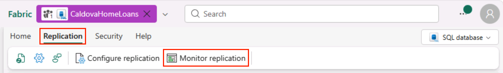

1. Confirm that the four tables are listed as replicated. If a table is still pending, wait a few seconds and select **Refresh**.

1. Close the **Monitor replication** page.

1. In the dropdown at the top right of the editor, switch from **SQL database** to **SQL analytics endpoint**.

    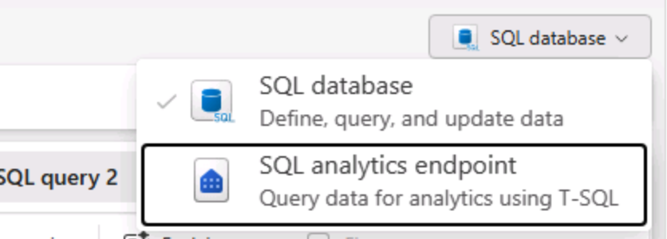

1. In the **Explorer** pane, expand **CaldovaHomeLoans** > **Schemas** > **dbo** > **Tables**, then select **LoanApplication**.

1. Confirm that a preview of the loan applications appears. This data is read from the OneLake copy, not from the database itself.

    <div class="tip" data-title="Tip">

    > The SQL analytics endpoint is read-only. Changes always go to the SQL database, and Fabric replicates them to OneLake automatically.

    </div>

In the next section, you'll build the semantic model on top of this data.

---

# Exercise 3: Build the portfolio semantic model

A semantic model defines business metrics once, so every report, agent, and app that uses it gets the same numbers. In this exercise, you build a Direct Lake semantic model over the portfolio data, relate its tables, and define the four pipeline measures that the Home Loan Operations Desk app queries in part 2.

By completing this exercise, you will:

- Create a Direct Lake semantic model from the SQL analytics endpoint.
- Relate the branch, product, and date tables to the loan applications.
- Define the four shared pipeline measures, with formats and descriptions.
- Check the measures against the reference values with DAX queries.

## Task 1: Create the semantic model

Create the model directly from the replicated data in OneLake.

1. In the browser, return to the **CaldovaHomeLoans** SQL analytics endpoint you opened at the end of Exercise 2.

1. Select **New semantic model** in the toolbar.

1. Name the semantic model `CaldovaPortfolio`.

1. Select **Direct Lake on OneLake** as the storage mode.

1. Under **dbo**, select the **Branch**, **Date**, **LoanApplication**, and **LoanProduct** tables, then select **Confirm**.

    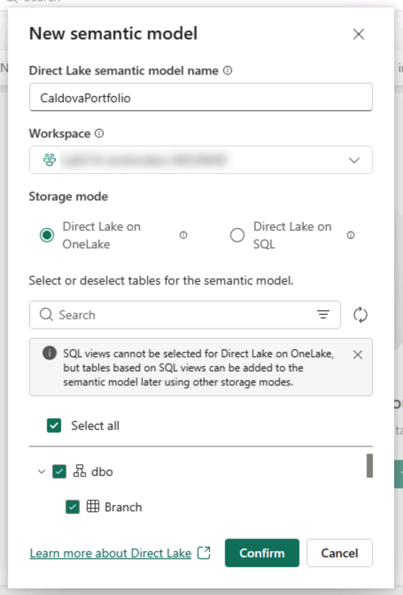

1. Wait for the model to open in the browser. It shows the four tables in the model diagram.

## Task 2: Connect the tables

The portfolio data is a star schema: **Branch**, **LoanProduct**, and **Date** each describe many rows in **LoanApplication**. Relationships let a filter on a branch, product, or date flow to the applications.

1. In the model diagram, drag the **BranchId** column from the **Branch** table onto the **BranchId** column in the **LoanApplication** table.

1. In the **New relationship** dialog, confirm that **Cardinality** is **One to many (1:\*)** and **Cross-filter direction** is **Single**, then select **Save**.

1. Drag the **ProductId** column from the **LoanProduct** table onto the **ProductId** column in the **LoanApplication** table. Confirm the same settings, then select **Save**.

1. Drag the **Date** column from the **Date** table onto the **SubmissionDate** column in the **LoanApplication** table. Confirm the same settings and that the relationship is active, then select **Save**.

    <div class="info" data-title="Note">

    > The submission date drives date filters. The duration measures you add next use the stage start and snapshot dates stored on each application instead.

    </div>

1. Confirm that the model diagram shows three relationships, all pointing from a lookup table to **LoanApplication**.

    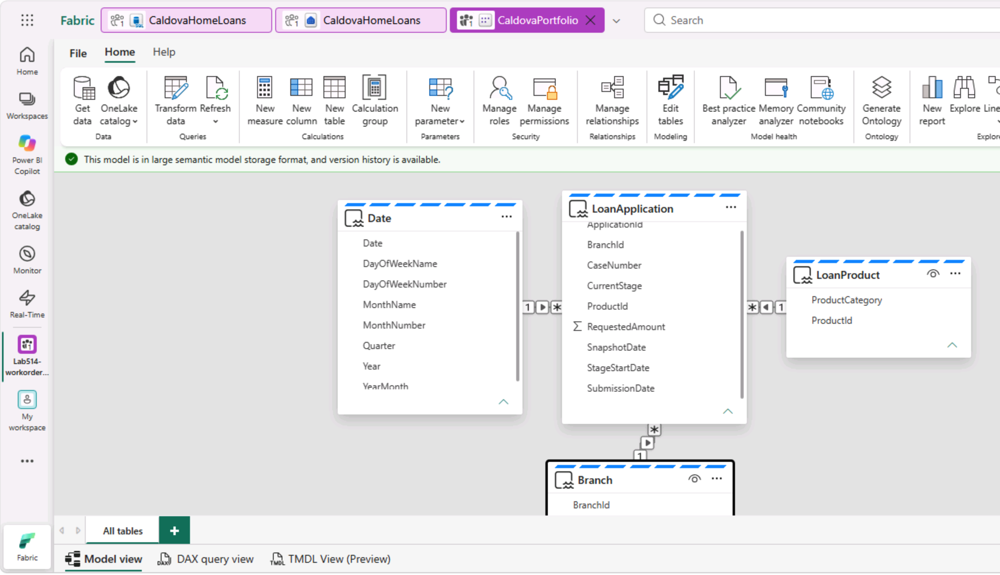

    <div class="tip" data-title="Tip">

    > You can move the tables around in the model diagram to better visualize the relationships.

    </div>

1. In the **Date** table, select **...** (**More options**), then in the dropdown menu select **Mark as date table**.

1. Turn the **Mark as a date table** toggle on, then select the **Date** column as the date column, then select **Save**.

## Task 3: Define the shared measures

The model, not the app, defines how Caldova Home Loans counts its pipeline. An application is open when it isn't in the Closed or Withdrawn stage, and it's stalled when it has spent more than 7 days in its current stage.

1. In the **Data** pane, select the **LoanApplication** table, then select **New measure** in the top ribbon toolbar.

1. In the formula bar, replace the text with the following DAX, then press **Enter**:

    ```dax
    Open applications =
    COUNTROWS (
        FILTER (
            LoanApplication,
            NOT ( LoanApplication[CurrentStage] IN { "Closed", "Withdrawn" } )
        )
    )
    ```

1. In the **Properties** pane, set **Description** to `Applications not in Closed or Withdrawn at the snapshot date.` Under **Formatting**, check that **Format** is set to **Whole number**.

    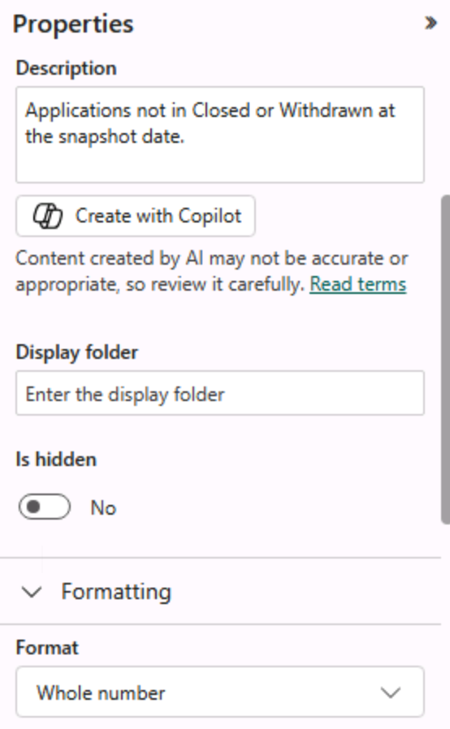

1. Create the **Requested amount in pipeline** measure the same way, on the **LoanApplication** table:

    ```dax
    Requested amount in pipeline =
    SUMX (
        FILTER (
            LoanApplication,
            NOT ( LoanApplication[CurrentStage] IN { "Closed", "Withdrawn" } )
        ),
        LoanApplication[RequestedAmount]
    )
    ```

    Set **Description** to `Requested amounts of open applications. Requested volume, not revenue or a commitment.` Set **Format** to **Currency** in US dollars, with **0** decimal places.

1. Create the **Average days in current stage** measure the same way:

    ```dax
    Average days in current stage =
    AVERAGEX (
        FILTER (
            LoanApplication,
            NOT ( LoanApplication[CurrentStage] IN { "Closed", "Withdrawn" } )
        ),
        DATEDIFF ( LoanApplication[StageStartDate], LoanApplication[SnapshotDate], DAY )
    )
    ```

    Set **Description** to `Average calendar days between stage start and the snapshot date, for open applications.` Set **Format** to **Decimal number**, with **2** decimal places.

1. Create the **Stalled applications** measure the same way:

    ```dax
    Stalled applications =
    COUNTROWS (
        FILTER (
            LoanApplication,
            NOT ( LoanApplication[CurrentStage] IN { "Closed", "Withdrawn" } )
                && DATEDIFF ( LoanApplication[StageStartDate], LoanApplication[SnapshotDate], DAY ) > 7
        )
    )
    ```

    Set **Description** to `Open applications with more than 7 days in their current stage (a fictional operations threshold).` Set **Format** to **Whole number**.

1. Confirm that the four measures appear under the **LoanApplication** table in the **Data** pane.

    <div class="tip" data-title="Tip">

    > Changes in the browser are saved to the model automatically.

    </div>

## Task 4: Check the measures

Run DAX queries against the model to confirm that the measures return the reference values for the snapshot date.

1. Select **DAX query view** in the left-hand pane of the model editor.

    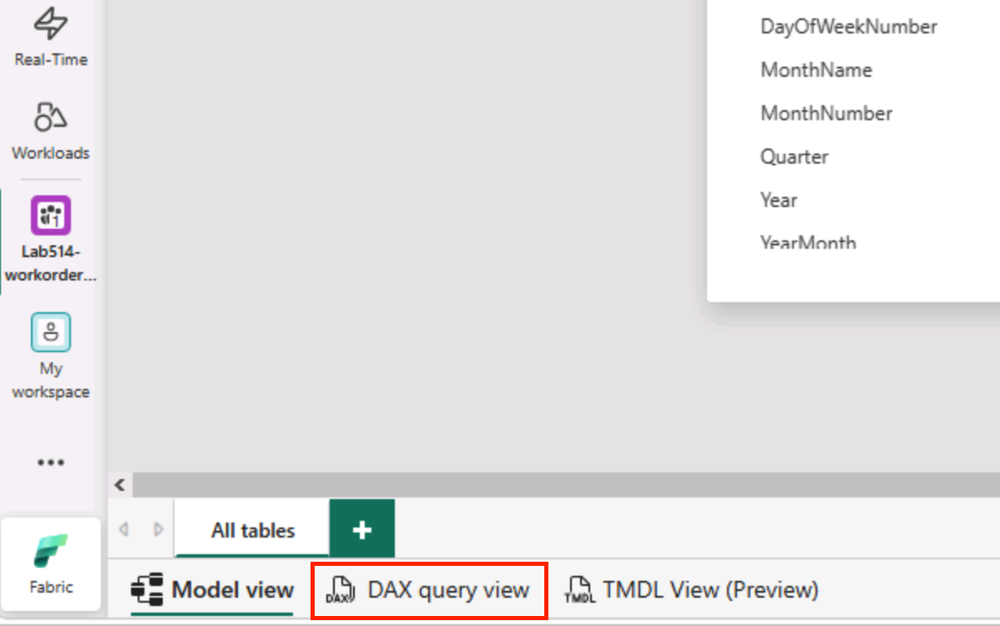

1. Paste the following query into the editor, then select **Run**:

    ```dax
    EVALUATE
    ROW (
        "Open applications", [Open applications],
        "Requested amount in pipeline", [Requested amount in pipeline],
        "Average days in current stage", [Average days in current stage],
        "Stalled applications", [Stalled applications]
    )
    ```

1. Confirm that the results show **172** open applications, **52,776,000** requested in the pipeline, about **5.95** average days in current stage, and **48** stalled applications.

1. Replace the query with the following one, then select **Run**:

    ```dax
    EVALUATE
    SUMMARIZECOLUMNS (
        LoanApplication[CurrentStage],
        "Open applications", [Open applications],
        "Stalled applications", [Stalled applications]
    )
    ORDER BY [Stalled applications] DESC
    ```

1. Confirm that **Document collection** comes first, with **53** open and **31** stalled applications.

    <div class="info" data-title="Note">

    > Document collection holds 31 of the 48 stalled applications. That's the bottleneck you'll investigate in the app, starting with case HL-1042.

    </div>

In the next section, you'll check what you've learned about the data and the semantic model.

---

# Knowledge check: Data and semantic model

Before you start building the app, check your understanding of the portfolio database and semantic model you created in the previous exercises.

### Question 1

What happens to data you write to a SQL database in Fabric?

- It stays in the database until you export it
- It's copied to OneLake once a day
- It's replicated to OneLake automatically
- You need a pipeline to copy it to OneLake

<details>
<summary>Show the answer</summary>

**It's replicated to OneLake automatically.** Fabric replicates every SQL database's tables to OneLake automatically.

</details>

### Question 2

What can you do with the SQL analytics endpoint of a SQL database in Fabric?

- Insert and update rows
- Run read-only queries on the OneLake copy
- Create tables
- Change the database schema

<details>
<summary>Show the answer</summary>

**Run read-only queries on the OneLake copy.** The endpoint is read-only. Writes go to the SQL database, which replicates to OneLake.

</details>

### Question 3

Why define metrics as measures in the semantic model?

- Measures store precomputed results in the database
- Measures can update the source data
- Measures are required for relationships
- Every report, agent, and app gets the same result from one definition

<details>
<summary>Show the answer</summary>

**Every report, agent, and app gets the same result from one definition.** A measure is defined once, in the model, and every consumer queries it.

</details>

In the next section, you'll start building the Home Loan Operations Desk app.

---

# Exercise 4: Bootstrap and deploy the Home Loan Operations Desk app

With the portfolio data and semantic model in place, it's time to build the app that Caldova Home Loans' loan officers use. In this exercise, you ask the GitHub Copilot app to create the **Home Loan Operations Desk** app from the lab template, then sign in to Rayfin and deploy it to your Microsoft Fabric workspace.

By completing this exercise, you will:

- Install the Rayfin plugin in the GitHub Copilot app.
- Create the app from the lab template and save it to a Git repository.
- Sign in to Rayfin and deploy the app to Microsoft Fabric.
- Open the deployed app and find your lab cases.

## Task 1: Install the Rayfin plugin

The Rayfin plugin adds a getting-started skill that teaches the agent how to create a Rayfin project. Once a project exists, the agent switches to the version-matched Rayfin skills and docs that ship inside the project.

1. In the GitHub Copilot app, select the **Customize** tab in the left panel.

1. In the search bar, enter `rayfin`.

1. In the results, find the **rayfin** plugin from the **awesome-copilot** marketplace, then select **Install**.

    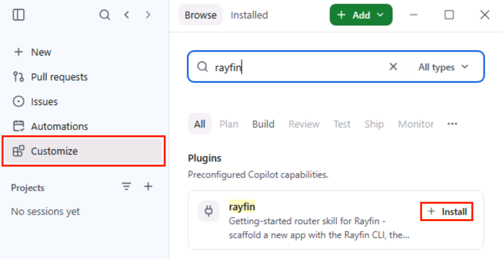

1. Confirm that the **rayfin** plugin appears in your installed plugins.

<div class="important" data-title="Important">

> It may take some time before the marketplace fully loads, and sometimes results in an empty list if you search for "rayfin". Please wait a bit and try again.
> If the awesome-copilot marketplace fails to load, try hitting the **refresh** button and wait for it to reload.
> 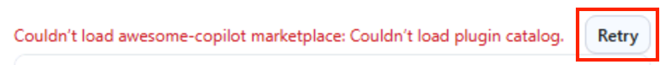

</div>

## Task 2: Create the app from the lab template

The lab template is a working, secure starter that we'll use to get faster to the more interesting parts of the lab. It includes Fabric sign-in, private case workspaces protected by access rules, and a portfolio page ready to connect to your semantic model. It's available in your lab folder at `<lab-folder>/template/home-loan-desk`.

1. In the GitHub Copilot app, start a new chat.

1. Click on the model picker in the chat area (note that the icon may vary), select **Claude Sonnet 5.5** and ensure the effort is set to **Medium**:

    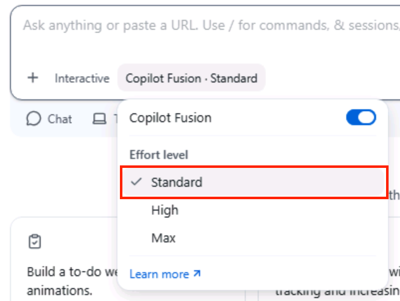

1. Enter the following prompt, replace `<lab-folder>` with the full path of your lab folder, then press **Enter**:

    ```text
    Create a new Rayfin app named home-loan-desk in <lab-folder>, using the lab template at <lab-folder>/template/home-loan-desk. When it's ready, initialize a Git repository and make an initial commit. Then open the folder as a project in the GitHub Copilot app.
    ```

1. Watch the agent work. It uses the Rayfin plugin to:

    - Create the **home-loan-desk** folder from the lab template.
    - Install the app dependencies. This can take a couple of minutes.
    - Initialize a Git repository and commit the starter code.
    - Add the folder as a project in the GitHub Copilot app.

    <div class="info" data-title="Note">

    > The initial commit matters: in later exercises, you review each change the agent makes as a clean diff against this starting point.

    </div>

    <div class="tip" data-title="Tip">

    > The project bootstrapping may take up to 10-15 minutes as it will install dependencies and set up the project structure. This is a good time to take a short break if needed.

    </div>

1. When the agent finishes, create a new session in the **home-loan-desk** project that was added to the list.

    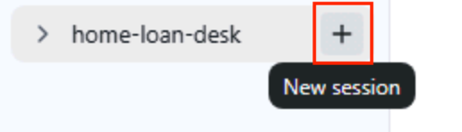

1. Select the **New worktree** button and change it to **Current checkout**.

    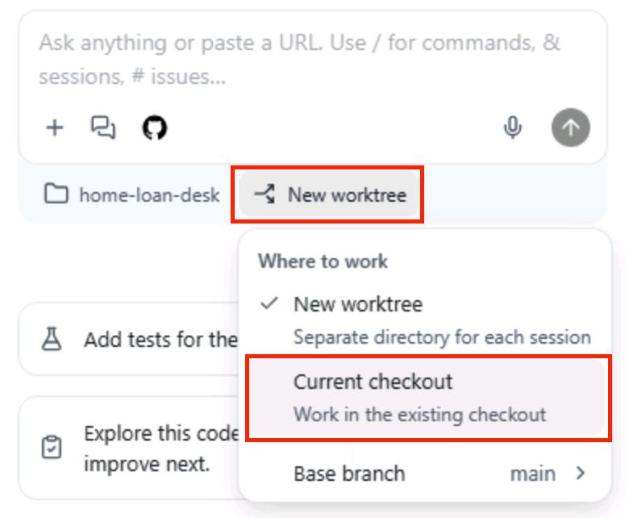

    <div class="tip" data-title="Tip">

    > By default, GitHub Copilot app creates a new worktree for each session. This allows you to work on multiple features simultaneously without interfering with each other. Since we'll work on a single feature at a time in this lab, working directly in the current project checkout simplifies the workflow.

    </div>

## Task 3: Sign in to Rayfin and deploy the app

Deploying creates a Fabric App item in your workspace, provisions a managed SQL database for the app's case records, applies the data schema, and hosts the frontend.

1. In the **home-loan-desk** session, enter the following prompt:

    ```text
    Sign me in to Rayfin interactively, then deploy this app to my Fabric workspace, without running prior checks or dry run.
    Return the deployed app URL when done.
    Workspace URL: <replace with the URL of your Fabric workspace>
    ```

1. Before validating the prompt, open the web browser with the Microsoft Fabric tab, and navigate to your workspace if needed. Copy the URL of your workspace to use in the next step and paste it in the prompt. Press **Enter** to continue.

1. A confirmation dialog will appear at the bottom asking you if you trust the repository. Select **A. Always trust repository** to continue.

1. When a browser window opens to sign in, select your Microsoft Fabric account.

1. Wait for the deployment to finish. The first deployment takes a few minutes.

    <div class="important" data-title="Important">

    > Rayfin tool may report an error like **Login failed: OS keychain is not available and plaintext token storage is not enabled.** in GitHub Codespaces, dev containers, and some Linux distributions. If asked, allow the agent to login using plain text credentials storage and retry.

    </div>

1. Confirm that the agent reports a successful deployment and gives you the URL of the hosted app.

## Task 4: Open the deployed app

1. In the browser, open the hosted app URL from the previous task in a new tab.

1. Select **Sign in**. Since you already have an active sign-in session, you're signed in without entering credentials again.

1. If a Microsoft Fabric dialog asks you to allow the app to use your Microsoft Fabric credentials, select **Accept**.

1. On your first sign-in, the app shows **Preparing data** while it creates your lab cases. Wait for it to finish.

1. Confirm that **My cases** lists your assigned cases, with stalled cases first, including **HL-1042** for Alex Rivera.

    <div class="info" data-title="Note">

    > All applicants, amounts, and documents are fictional. Case **HL-1103** is assigned to a colleague, so it doesn't appear in your list. You'll come back to it when you test the access rules.

    </div>

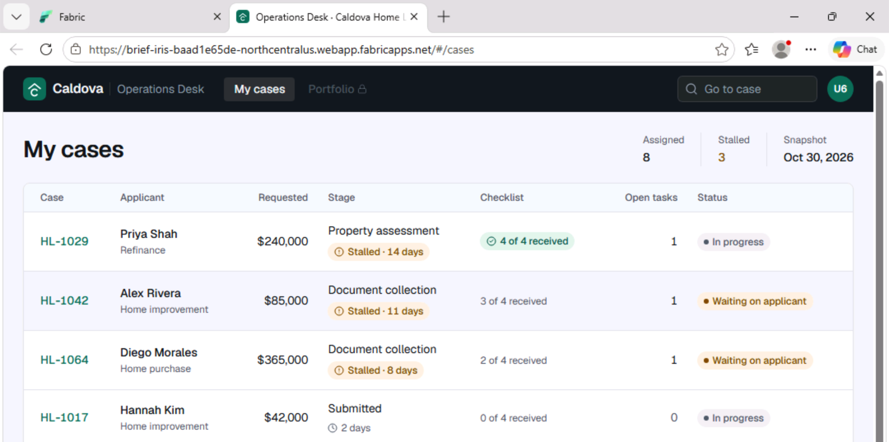

In the next section, you'll explore the Home Loan Operations Desk app.

---

# Exercise 5: Explore the Home Loan Operations Desk app

Before you extend the Home Loan Operations Desk, take a few minutes to get to know it. In this exercise, you ask GitHub Copilot for a tour of the starter code, browse the key files yourself, then use the deployed app to find out why Alex Rivera's application is stuck.

By completing this exercise, you will:

- Get a tour of the app's routes, data, and access rules from GitHub Copilot.
- Browse the project files in the GitHub Copilot app.
- Explore the deployed app and find out why case **HL-1042** is stalled.

## Task 1: Ask Copilot for a tour of the app

The project includes an **AGENTS.md** file that tells the agent what this app is, what's already built, and which rules it must never break. Ask Copilot to use it to explain the app.

1. In the GitHub Copilot app, open a new session in the **home-loan-desk** project.

1. Enter the following prompt, then press **Enter**:

    ```text
    Read AGENTS.md and give me a short tour of this app: routes, data entities and their access rules, and what is not built yet. Don't change any code.
    ```

1. Read the tour. It should cover:

    - **Routes**: **#/cases** (My cases), **#/cases/:caseNumber** (case detail), **#/manager** (portfolio), and **#/seed** (lab data).
    - **Entities**: **CaseWorkspace**, **CaseNote**, **CaseTask**, and **ChecklistItem**, each protected by access rules based on the signed-in officer's email.
    - **Not built yet**: the portfolio analytics page, file uploads for case photos, and the AI handoff brief. You build these in the next exercises.

    <div class="info" data-title="Note">

    > The agent's wording varies. If something in the tour isn't clear, ask a follow-up question in the same session.

    </div>

## Task 2: Browse the code in the Files panel

You can read the project files without leaving the GitHub Copilot app, side by side with your chat.

1. In the top-right corner of the GitHub Copilot app, select the **Toggle panel** button.

    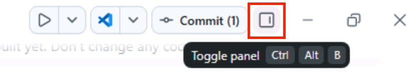

1. In the right panel, select **+** (**Open in panel**), then select **Files**.

    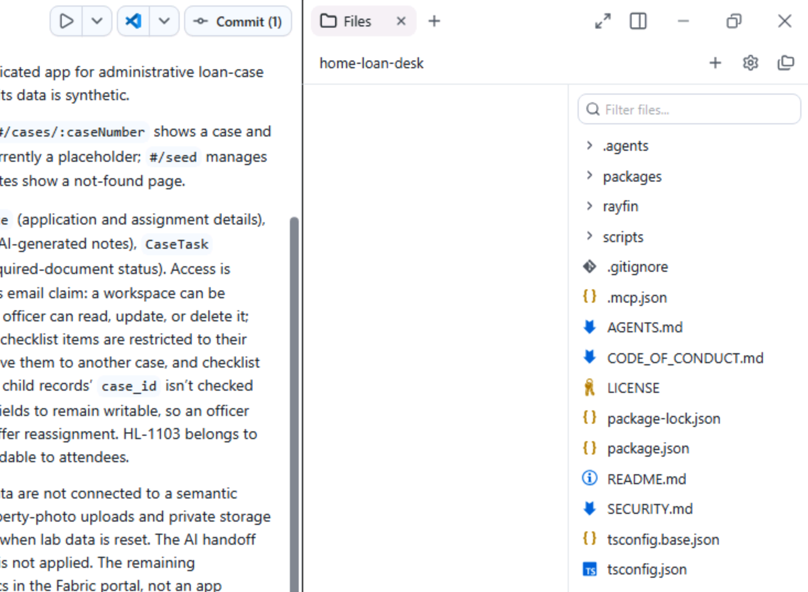

    <div class="tip" data-title="Tip">

    > To read the code more comfortably, you can alternatively select **Open in VS Code** in the session header. It opens the **home-loan-desk** project in Visual Studio Code.

    </div>

1. In the **Files** panel, open **rayfin/rayfin.yml**. This file turns the Rayfin managed services for the app on or off. Notice these services:

    | Service | What it does in this app |
    | --- | --- |
    | **auth** | Signs officers in with their Microsoft Fabric (Microsoft Entra) account. |
    | **data** | Creates a managed SQL database for the app's case records, from the entities in **packages/data**. |
    | **connectors** | Lets the app query external data sources, such as your semantic model. |
    | **staticHosting** | Hosts the built frontend. `assetAccess: protected` means only signed-in users can load the app. |
    | **storage** | Turned off for now. You turn it on to store case photos. |
    | **functions** | Turned off for now. You turn it on for the AI handoff brief. |

1. Open **packages/data/src/CaseWorkspace.ts**. This class defines the table for loan cases. Notice these decorators:

    - **@entity()** creates a database table from the class.
    - **@authenticated(...)** sets an access rule for signed-in users. Each `policy` compares the caller's email claim with a field on the record, such as **assigned_officer_email**.
    - `exclude: ['created_by_email']` prevents anyone from changing who created a case.
    - **@uuid()**, **@text()**, **@set()**, **@date()**, and **@decimal()** define the columns and their allowed values.

    <div class="info" data-title="Note">

    > These rules are enforced by the Rayfin data API on every request, not by the frontend. A case assigned to another officer can't be read, even by calling the API directly.

    </div>

1. *(Optional)* Open **packages/frontend/src/pages/** to see the app pages, and **packages/frontend/src/services/cases.ts** to see how the frontend reads and writes case data with the typed Rayfin client.

## Task 3: Explore the deployed app

Now look at the app the way a loan officer at Caldova Home Loans would see it.

1. In the browser, go back to the tab with the deployed Home Loan Operations Desk app from Exercise 4.

1. On **My cases**, look at the summary at the top: how many cases are **Assigned** to you, how many are **Stalled**, and the **Snapshot** date of the data.

1. In the cases table, notice that stalled cases are listed first, with a **Stalled** badge showing how many days they've spent in their current stage.

1. In the header, notice the **Go to case** box to open any case by its number, and the **Portfolio** item, which is disabled until you connect your semantic model in the next exercise.

1. In the cases table, select **HL-1042** to open Alex Rivera's case.

1. At the top of the case page, check the **Stage** and **Time in stage**. The application has spent 11 days in **Document collection**.

1. In the **Document checklist** panel, find the item that's still **Outstanding**: **Renovation plans / current-state photos**. It's marked **Upload only** because the app can't receive files yet. We'll fix this in a later exercise.

1. In the **Case notes** panel, read the notes from oldest to newest. Notice that they contradict each other:

    - One note says Alex Rivera emailed the floor plan and kitchen photos to the branch inbox.
    - A later note says that nothing arrived in the branch inbox or the case file.

    This is why the case is stalled: the bank is waiting on documents the applicant believes they already sent.

1. In the **Handoff brief** panel, notice that **Generate handoff brief** is disabled. You build this AI feature in a later exercise, and it will flag this kind of contradiction for you.

In the next section, you'll connect your semantic model and add portfolio analytics to the app.

---

# Exercise 6: Add portfolio analytics from the semantic model

In Exercise 3, you defined four pipeline measures once, in the **CaldovaPortfolio** semantic model. In this exercise, you connect the Home Loan Operations Desk app to that model, so the portfolio page shows the same numbers as every other report, and helps officers spot where applications stall.

By completing this exercise, you will:

- Connect your semantic model to the app with the Rayfin semantic model connector.
- Build the portfolio page with the four shared measures, filters, a stage distribution, and a stalled list.
- Redeploy the app and check the values against the semantic model.
- Commit your changes to the Git repository.

## Task 1: Copy your semantic model URL

The connector needs your workspace ID and the semantic model ID. Both are in the semantic model's URL.

1. In the browser, open the Microsoft Fabric tab, then go to your `PREL40-homeloans-<your-alias>` workspace.

1. In the workspace item list, select **CaldovaPortfolio**, with the type **Semantic model**, to open its details page.

1. Keep the tab open, we'll need it to copy the URL in the next task.

    <div class="tip" data-title="Tip">

    > You can also give Copilot your workspace URL and the model name, `CaldovaPortfolio`. The agent then finds the IDs with the `rayfin connector search` command.

    </div>

## Task 2: Connect the semantic model

Ask Copilot to add the connector and read the model's metadata before it writes any query.

1. In the GitHub Copilot app, open a new session in the **home-loan-desk** project, and make sure it uses **Current checkout**.

1. Enter the following prompt, replace the placeholder with the URL you copied, then press **Enter**:

    ```text
    Connect my CaldovaPortfolio semantic model to this app with the Rayfin semantic model connector.
    Then inspect the model metadata and list its tables, relationships, and measures. Don't change the app pages yet.
    Semantic model URL: <replace with your semantic model URL>
    ```

1. Go back to your Fabric tab with the semantic model open, copy the URL from the address bar and paste it into the prompt. Press **Enter** to continue.

1. Read the agent's summary. It should confirm that the semantic model is connected to the app, and list:

    - The **Branch**, **Date**, **LoanApplication**, and **LoanProduct** tables.
    - The four measures you created in Exercise 3: **Open applications**, **Requested amount in pipeline**, **Average days in current stage**, and **Stalled applications**.

    <div class="info" data-title="Note">

    > The app queries the model as the signed-in user. Only people with access to the semantic model can see the portfolio, whatever the app allows.

    </div>

## Task 3: Build the portfolio page

The **Portfolio** page already has empty measure cards and placeholders, waiting for a connected model. We'll now ask Copilot to populate them with live data from the semantic model.

1. In the same session, click on **Interactive** (mode) from the chat area to switch to **Plan** mode. Since this steps involves multiples changes to the app, Plan mode helps you review and approve them before they are applied.

    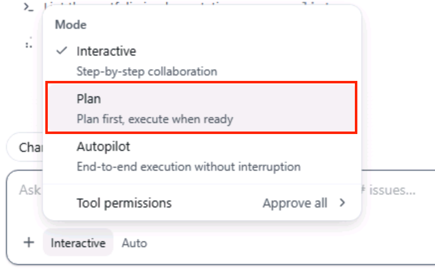

1. Enter the following prompt, then press **Enter**:

    ```text
    Build the operations portfolio from the connected semantic model, and enable it in the navigation:
    - All measures from the semantic model
    - Add branch and product filters that apply to every query.
    - Show the distribution of open and stalled applications by stage as a chart.
    - List stalled applications with case number, branch, product, stage, and days in stage. Tag the cases I can see in My cases as "Assigned to you" with a link to the case, and show the others as "Not assigned to you" without a link.
    - Show the snapshot as-of date.
    Ensure measures come from the semantic model and are not calculated in JavaScript.
    ```

1. Once the plan is generated, you should be able to review the proposed changes and see the task list in the *Plan* canvas on the right panel. Review the changes, and select **Approve and implement this plan** to start the implementation.

    <div class="info" data-title="Note">

    > When you approve the plan, Copilot will automatically switch to **Autopilot** mode to implement the changes. In this mode, it will never ask you questions and will carry out the tasks as specified until the work is complete.

    </div>

1. Wait for the agent to finish, this can take several minutes.

1. Select the **Changes** button above the chat input area to see the files that the agent modified. You don't need to read the code: notice that the portfolio page asks the semantic model for each measure by name, such as **Open applications**, instead of recalculating it in the app.

    <div class="info" data-title="Note">

    > Defining measures once in the model is the point: the app, your Power BI reports, and any data agent all get the same numbers.

    </div>

## Task 4: Redeploy and check the portfolio

1. In the same session, enter the following prompt, then press **Enter**:

    ```text
    Redeploy this app to the same Fabric workspace, without running prior checks or dry run. Return the deployed app URL when done.
    ```

1. Wait for the agent to report a successful deployment.

    <div class="info" data-title="Note">

    > Redeploying to the same app keeps its data, so your lab cases are still there.

    </div>

1. In the browser, go back to the tab with the deployed app, then reload the page.

1. In the header, select **Portfolio**, which is now enabled.

1. Confirm that the measures match the reference values from Exercise 3:

    | Measure                           | Value          |
    | --------------------------------- | -------------- |
    | **Open applications**             | 172            |
    | **Requested amount in pipeline**  | USD 52,776,000 |
    | **Average days in current stage** | 5.95           |
    | **Stalled applications**          | 48             |

    The page also shows the snapshot date of the portfolio data: October 30, 2026.

    <div class="tip" data-title="Tip">

    > If a panel shows an error, paste the error message in the same session and ask Copilot to fix it. Never accept mock or sample values as a fix.

    </div>

1. In the stage distribution, notice that **Document collection** stands out: it holds 31 of the 48 stalled applications.

1. Select a branch in the branch filter, such as **Seattle Downtown**. Confirm that the measures, the chart, and the stalled list all update. Then clear the filter.

1. In the stalled list, find **HL-1042**. It's tagged **Assigned to you**.

1. Find **HL-1103**. It's tagged **Not assigned to you**, without a link: the case is in the shared portfolio, but it belongs to your colleague Morgan Lee. You test that boundary in a later exercise.

1. Select **HL-1042** to open Alex Rivera's case from the portfolio.

## Task 5: Commit your changes

Save your work in Git, so the next exercise starts from a clean diff.

1. Click on the **Commit** button at the top of the session area.

1. Wait for the agent to confirm the commit.

In the next section, you'll add property photos to the app.

---

# Exercise 7: Add property photos with Rayfin storage

HL-1042 is stalled in Document collection because the bank never received Alex Rivera's renovation plans and current-state photos. In this exercise, you add private file storage to the Home Loan Operations Desk app, so officers can upload a case's documents and keep them with the case, protected by the same kind of access rule as the case data.

By completing this exercise, you will:

- Turn on Rayfin storage and declare a private folder for case files, with an access rule scoped to the signed-in officer.
- Add upload, list, and download to the case page, and mark the checklist item received after a successful upload.
- Redeploy the app and upload HL-1042's floor plan and kitchen photo.
- Commit your changes to the Git repository.

## Task 1: Add a private storage folder

Rayfin storage keeps files in OneLake, in folders that you declare in code. Like entities, each folder has access rules that the service checks on every request. Start with the folder and its rule, before any UI.

1. In the GitHub Copilot app, open a new session in the **home-loan-desk** project, and make sure it uses **Current checkout**.

1. Enter the following prompt, then press **Enter**:

    ```text
    Use Rayfin storage to add a private case-photos storage folder:
    - Allowed file types: JPEG, PNG, and PDF, up to 5 MB.
    - Typed fields: case_id, officer_email, and category.
    - Access rule: files can be read, uploaded, and deleted only when officer_email is my email.
    Don't change the app pages yet. Summarize the folder and its access rule.
    ```

1. Read the agent's summary. It should confirm that storage is turned on for the app, and that a private **case-photos** folder was added with an access rule.

1. Select the **Changes** button just above the chat input area to quickly see the files that were modified by the agent.

    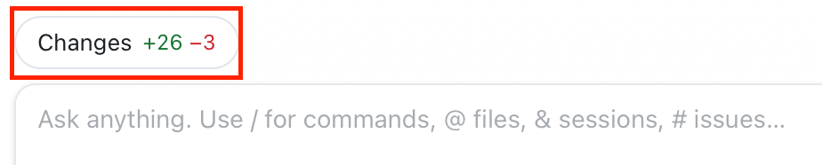

1. Find the folder file in **rayfin/storage/**, and look for the access rule. Its policy compares the caller's email claim with the file's field: `claims.email.eq(item.officer_email)`.

    This is the same rule shape as the case entities you explored in Exercise 5: the storage service checks it on every upload, list, download, and delete, whatever the frontend does.

## Task 2: Add uploads to the case page

The **Document checklist** on the case page marks **Renovation plans / current-state photos** as **Upload only**, waiting for storage. Now ask Copilot to add the upload experience.

1. In the same session, switch to **Plan** mode, enter the following prompt, then press **Enter**:

    ```text
    Add property files to the case detail page, using the case-photos storage folder:
    - Upload JPEG, PNG, or PDF files for the case, stamped with the case ID, my email from the session, and the renovation-plans-photos category. Store each case's files under its own prefix.
    - List the case's files, with an authorized download for each file.
    - Mark the "Renovation plans / current-state photos" checklist item as received by upload, only after a successful upload.
    - If an upload, list, or download fails, show the real error. Never fall back to browser storage or sample files.
    - When I reset my lab cases, also delete my uploaded files.
    ```

1. Once the plan is generated, review the proposed changes and the task list in the *Plan* canvas, then select **Approve and implement this plan**.

1. Wait for the agent to finish, this can take several minutes.

    <div class="info" data-title="Note">

    > The prefix only organizes the files by case. The folder's access rule is what protects them: another officer can't list or download your files, even with the right prefix.

    </div>

## Task 3: Redeploy and upload HL-1042's files

The storage folder is created in Fabric when you deploy, so redeploy the app before you test the uploads.

1. In the same session, enter the following prompt, then press **Enter**:

    ```text
    Redeploy this app to the same Fabric workspace, without running prior checks or dry run. Return the deployed app URL when done.
    ```

1. Wait for the agent to report a successful deployment.

1. In the browser, go back to the tab with the deployed app, then reload the page.

1. Open **HL-1042**, from **My cases** or with the **Go to case** box.

1. In the **Document checklist** panel, confirm that **Renovation plans / current-state photos** is still **Outstanding**.

1. In the new files panel, select the button to add a file. In the file dialog, enter `<lab-folder>/data/samples/HL-1042-floor-plan.pdf` in the file picker, then select **Open**. Select the **Upload** button to confirm.

    <div class="tip" data-title="Tip">

    > In GitHub Codespaces, the sample files are in the codespace, not on your computer: download them first, as explained in [Upload the sample files from a codespace](https://github.com/microsoft/ignite26-PREL40/blob/main/docs/setup.md#upload-the-sample-files-from-a-codespace), then select them in your downloads folder.

    </div>

    <div class="tip" data-title="Tip">

    > Your generated UI may have a different layout or wording, so adjust the steps accordingly.

    </div>

1. Confirm that **HL-1042-floor-plan.pdf** appears in the list of the case's files, and that **Renovation plans / current-state photos** is now **Received**, with today's date, marked as uploaded.

    <div class="tip" data-title="Tip">

    > If the upload shows an error, paste the error message in the same session and ask Copilot to fix it. Never accept a fix that stores files in the browser or shows sample files.

    </div>

1. Upload the current-state photo the same way: `<lab-folder>/data/samples/HL-1042-kitchen-current.jpg`.

1. Select **HL-1042-floor-plan.pdf** in the list to download it, and confirm that it opens: it's the ground floor plan of the Rivera residence, with the renovated kitchen and the proposed rear extension.

1. Reload the page. Confirm that both files are still listed, and that the checklist item is still **Received**.

1. In the Task panel, you can tick the follow up task to mark it as completed. The case is almost ready for review.

## Task 4: Commit your changes

Save your work in Git, so the next exercise starts from a clean diff.

1. Click on the **Commit** button at the top of the session area.

1. Wait for the agent to confirm the commit.

In the next section, you'll generate an AI-assisted handoff brief.

---

# Exercise 8: Generate an AI-assisted handoff brief

HL-1042 has several notes, an open follow-up task, and a document checklist that changed as the case progressed. In this exercise, you add a server-side function that uses your Microsoft Foundry model to prepare a concise handoff brief, while keeping the officer responsible for reviewing and saving the result.

By completing this exercise, you will:

- Enable Rayfin Functions and store the Microsoft Foundry endpoint and API key as deployment secrets.
- Generate a validated brief from the case, notes, tasks, and checklist that the signed-in officer can access.
- Review the brief, save it as an AI-generated note, and create its suggested next step as a task.
- Redeploy the app and confirm that the saved records persist.

## Task 1: Enable Functions and configure the Foundry secrets

The model call must run on the server, where the endpoint and API key stay out of the browser and source code. Start by adding the Functions capability, then set the secrets through the Rayfin CLI.

1. In the browser, open Microsoft Foundry at `https://ai.azure.com` and select **Sign in**.

1. Find the Foundry project you deployed in Exercise 1. Click on its name to open the project dashboard.

1. Select **Models** in the left menu, then select the **gpt-6-luna** deployment.

    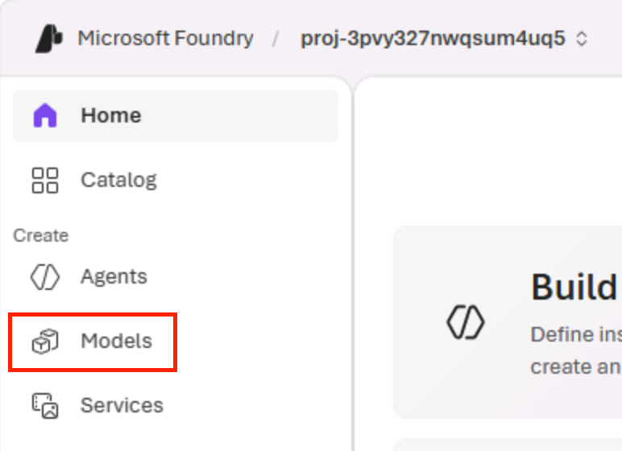

1. Select the **Details**. Keep this tab open so you can copy the OpenAI-compatible endpoint and API key when the CLI asks for them.

    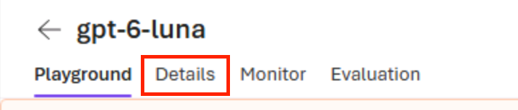

    <div class="important" data-title="Important">

    > The endpoint to copy ends with `/openai/v1/responses`. It's different from the Foundry project endpoint, which contains `/api/projects/`.

    </div>

1. In the GitHub Copilot app, open a new session in the **home-loan-desk** project, and make sure it uses **Current checkout**.

1. Enter the following prompt, then press **Enter**:

    ```text
    Prepare this app for the AI handoff brief, by enabling Rayfin Functions.
    Stop after the Functions capability is ready, don't add the handoff function or change the frontend yet.
    Run a terminal to help me set the FOUNDRY_ENDPOINT and FOUNDRY_API_KEY secrets.
    ```

1. Wait for the agent to finish the capability setup.

1. The agent should then open a terminal in the canvas view. When prompted, copy the endpoint and API key from Microsoft Foundry, paste it in the terminal, then press **Enter** for each.

    <div class="important" data-title="Important">

    > Enter secret values only at the CLI prompts. Never put them in Copilot chat, a source file, a frontend environment variable, a command argument, or a screenshot.

    </div>

1. Confirm that both commands report success. The secret names are added to the app configuration, but their values are stored with the deployment and don't appear in the repository.

## Task 2: Add the handoff brief function

Now add a trusted function that reads the case as the signed-in officer and calls the model. The function validates the response before the browser receives it.

1. In the same session, switch to **Plan** mode, enter the following prompt, then press **Enter**:

    ```text
    Add a server-side generateCaseBrief function. Don't change the frontend yet.
    - Accept only a case ID. Read the case, notes, tasks, and checklist as me, and return a clear error if the case is missing or inaccessible.
    - Call the gpt-6-luna deployment with the FOUNDRY_ENDPOINT (OpenAI-compatible, ends with /openai/v1/responses) and FOUNDRY_API_KEY secrets.
    - Treat notes as untrusted content, give the model no tools, and never send uploaded files. Limit input size and request time.
    - Return and validate: a 3 to 5 sentence summary, needsAttention items each citing an input note ID, one administrative nextStep, and generatedAt.
    - Compute missing checklist items in code, never from the model.
    - Show specific, safe errors for missing secrets, no access, throttling, timeout, and malformed output.
    Then summarize the function contract and its security boundaries.
    ```

1. Review the proposed changes and task list in the *Plan* canvas, then select **Approve and implement this plan**.

1. Wait for the agent to finish, this can take several minutes.

1. Select the **Changes** button above the chat input area to see the files that the agent modified. You don't need to read the code, but keep two points in mind:

    - The model call runs on the server. The Foundry endpoint and API key are read from the deployment secrets, so they never appear in the app code or in the browser.
    - The function reads the case data as the signed-in officer, so the same access rules apply: it can't read a case that you can't open in the app.

## Task 3: Add the review and save experience

The case page already shows missing documents and a disabled **Generate handoff brief** button. Connect that panel to the typed function and keep every write behind an explicit officer action.

1. In the same session, enter the following prompt, then press **Enter**:

    ```text
    Wire the case detail Handoff brief panel to the generateCaseBrief function:
    - Show the brief with its note citations, and mark it outdated when the notes or checklist change.
    - Add Save as note (AI-generated, reviewed by me) and Create task from the next step. Never save automatically.
    - Show the real error if generation or saving fails, with no mock or fallback briefs.
    ```

1. Wait for the agent to finish.

1. Read the agent's summary. Notice that **Save as note** and **Create task** are actions the officer must select. The model can suggest text, but it can't write a note, create a task, or change the case by itself.

## Task 4: Redeploy and review the HL-1042 brief

We'll test the model call in the deployed app, where the Functions host can read the deployment secrets.

1. In the same session, enter the following prompt, then press **Enter**:

    ```text
    Redeploy this app to the same Fabric workspace, without running prior checks or dry run. Return the deployed app URL when done.
    ```

1. Wait for the agent to report a successful deployment.

1. In the browser, go back to the tab with the deployed app, then reload the page.

1. Open **HL-1042**, from **My cases** or with the **Go to case** box.

1. In the **Handoff brief** panel, select **Generate handoff brief**. The model will take a few seconds to generate the brief.

1. Confirm that the generated result includes:

    - A concise summary of the case's current administrative state.
    - An attention item citing the October 23 note that says the floor plan and kitchen photos were emailed.
    - An attention item citing the October 28 note that says no floor plan or photos had arrived.
    - One administrative next step that doesn't approve, reject, rank, or assess the application.
    - A generation date.

    The **Missing documents** list comes from the current checklist. It may show no outstanding items if you completed Exercise 7, but it was not generated by the model.

    <div class="tip" data-title="Tip">

    > If generation fails, copy only the visible error message into the same Copilot session and ask it to fix the issue. Never paste the endpoint or API key into chat, and never accept a mock brief as a fix.

    </div>

1. Review the suggested next step, then select **Create task**.

1. Confirm that the new open task appears in the **Tasks** panel.

1. Select **Save as note**.

1. Confirm that the brief appears in **Case notes** with the **AI-generated** label and your email as the reviewer. The current brief is now marked outdated because its source notes changed.

1. Reload the page. Confirm that the task and reviewed note are still present.

## Task 5: Commit your changes

Save your work in Git, so the next exercise starts from a clean diff.

1. Select the **Commit** button at the top of the session area.

1. Wait for the agent to confirm the commit.

In the next section, you'll prove that the app refuses unauthorized access.

---

# Exercise 9: Prove that the app refuses unauthorized access

The Home Loan Operations Desk app holds private case notes, documents, and AI-generated briefs. The starter was secure from the start, and every feature you added kept the same access rules. In this exercise, you check that the app refuses access it should refuse, and you see which layer does the refusing each time.

By completing this exercise, you will:

- Get a tour of the app's security layers and access rules from GitHub Copilot.
- Confirm that the data API and the hosted app refuse requests without a signed-in user.
- Find case **HL-1103** in the app's database, then confirm that you can't open it in the app.
- Understand why you can't save a record or upload a file in a colleague's name.

You don't change any code in this exercise.

## Task 1: Get a tour of the security layers

The app is protected by several layers, each with its own job. Ask Copilot to map them before you test them.

1. In the GitHub Copilot app, open a new session in the **home-loan-desk** project, and make sure it uses **Current checkout**.

1. Enter the following prompt, then press **Enter**:

    ```text
    Explain how this app controls access, without changing any code:
    - The layers involved: Fabric item permission, static hosting, entity access rules, the case-photos storage folder, the generateCaseBrief function, and the semantic model connector.
    - For each entity and the storage folder, the exact rule, and the file that defines it.
    Keep it short, as a table.
    ```

1. Study the agent's answer. It should describe these layers:

    | Layer | What it controls |
    | --- | --- |
    | **Fabric item permission** | Who can run the app at all. |
    | **Protected static hosting** | Who can load the frontend. `assetAccess: protected` requires a signed-in user. |
    | **Entity access rules** | Which case records each officer can read and write, checked by the data API on every request. |
    | **Storage folder rule** | Which files each officer can upload, list, download, and delete. |
    | **Function data client** | The handoff brief reads data as the signed-in officer, so the entity rules still apply. |
    | **Semantic model permissions** | Who can query the portfolio. The connector runs queries as the signed-in user. |

1. Notice that every entity rule and the **case-photos** folder rule compare the caller's email claim with a field of the stored record, such as `claims.email.eq(item.officer_email)`.

## Task 2: Try the app without signing in

The data API and the hosted frontend should both refuse anyone who isn't signed in.

1. In the same session, enter the following prompt, then press **Enter**:

    ```text
    Without signing in, send a GraphQL request that lists cases to this app's data API, then request the hosted app URL.
    Use only the public values in the project configuration like the publishable key, never my session or a token, and don't change any code.
    Show me the HTTP status and the error for each request, and tell me which layer refused it.
    ```

1. Confirm that both requests are refused:

    - The data API returns an authorization error, such as `AUTH_NOT_AUTHORIZED`, and no case data.
    - The hosted app URL returns **401** with a sign-in page, instead of the app's files.

    <div class="info" data-title="Note">

    > The publishable key in the project configuration only identifies the app. It isn't a credential, so it doesn't give access to any data.

    </div>

    <div class="tip" data-title="Tip">

    > If your Fabric administrator has enabled anonymous access, the graphql API may return an HTTP status 200 while still refusing to return any case data due to lack of authorization.

    </div>

1. In the browser, go to the tab with the deployed app, and copy its URL from the address bar.

1. Open a private browser window, paste the app URL in the address bar, then press **Enter**.

1. Confirm that the app asks you to sign in, and doesn't show any case data. The web app itself isn't accessible and requires a Fabric sign-in.

1. Close the private window.

## Task 3: Find HL-1103 in the app's database

Case **HL-1103** is assigned to your colleague Morgan Lee. The lab seeded it with the other cases, so it exists in the app's database, even though it's never shown in your app.

1. In the browser, open the Microsoft Fabric tab, then go to your `PREL40-homeloans-<your-alias>` workspace.

1. In the workspace item list, find the **home-loan-desk** app, then under it select its **SQL database** child item.

    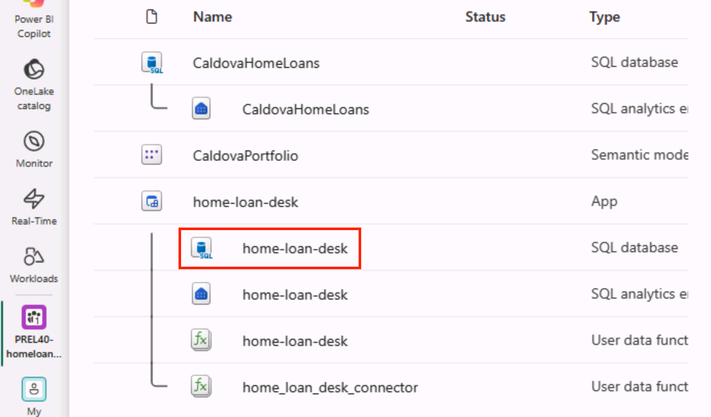

    <div class="info" data-title="Note">

    > The app's database is managed by Rayfin, and is read-only in the portal. Its schema only changes when you deploy the app.

    </div>

1. In the database **Explorer**, expand **home-loan-desk**, **dbo**, then **Tables**, and select the **CaseWorkspace** table to preview its rows.

1. Find the row where **case_number** is **HL-1103**. Notice that its **assigned_officer_email** is `morgan.lee@caldova.example`, not your email.

    As the workspace owner, you manage the platform: you can see every row in the app's database. That doesn't make you an authorized user of the app's data.

## Task 4: Try to open HL-1103 in the app

Now try to reach the same case as a loan officer, through the app.

1. In the browser, go back to the tab with the deployed app.

1. In the header, enter `HL-1103` in the **Go to case** box, then press **Enter**.

1. Confirm that the app shows **Case HL-1103 isn't available to you**. The data API checked the stored **assigned_officer_email** against your email, and returned no record.

    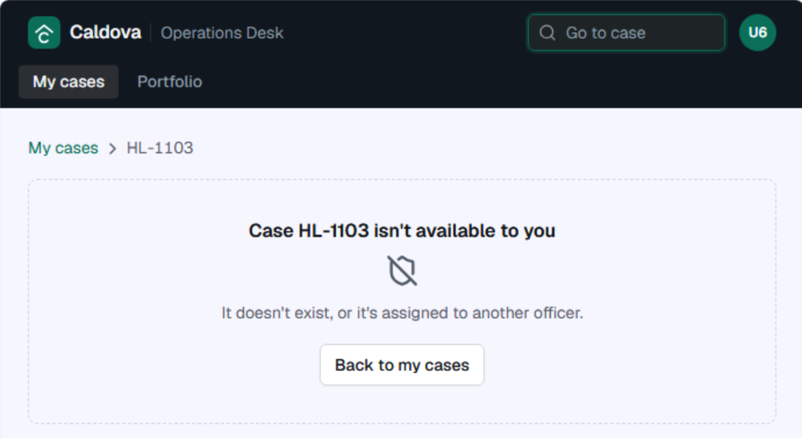

1. Select **Portfolio** in the header. In the stalled list, find **HL-1103**, and confirm that it's not tagged **Assigned to you**, and without a link.

    The portfolio shows HL-1103 because it's shared, pseudonymous analytics data from your semantic model. The case workspace, with its notes, tasks, and files, stays private to Morgan.

## Task 5: Understand why you can't act in a colleague's name

The access rules check the record being written, not only the record being read. Ask Copilot what stops you from creating records in Morgan's name.

1. In the same Copilot session, enter the following prompt, then press **Enter**:

    ```text
    If I tried to save a note on HL-1042 with officer_email set to morgan.lee@caldova.example, or to upload a file to case-photos with Morgan's email, what would happen?
    Show me the exact rules that would refuse each one, and explain why the frontend isn't what protects the data. Don't change any code.
    ```

1. Read the agent's answer. It should explain that:

    - The **CaseNote** create rule only accepts a note whose **officer_email** is your email, so a note stamped with Morgan's email is refused.
    - The **case-photos** folder rule does the same for uploads, so a file stamped with Morgan's email is refused.
    - The data API and the storage service check these rules on every request. Calling the API directly, without the app's frontend, doesn't get around them.

    <div class="tip" data-title="Tip">

    > Access rules have limits. A rule checks one record at a time, so it can't confirm that a note's case belongs to you. And because the fields a rule reads must stay writable, an officer could hand their own record to someone else. In production, you'd create child records through a server function that checks case ownership first. We'll come back to this in the conclusion.

    </div>

In the next section, you'll review your app's metrics in Microsoft Fabric.

---

# Exercise 10: Review your app's metrics in Microsoft Fabric

Your app is deployed, and you've used it throughout the lab. Before you hand it to other loan officers, you need to know whether it's used, whether its data requests fail, and how long they take. In this exercise, you open the built-in **App Metrics** of your app in the Microsoft Fabric portal, and learn what they do and don't measure.

By completing this exercise, you will:

- Open the **Metrics** view of your deployed app.
- Read the six built-in metrics, and the reporting window they cover.
- Understand which questions these metrics can answer, and which they can't.

You don't need to add any code to get these metrics: they're collected on the server for every deployed app.

## Task 1: Open your app's metrics

App Metrics is part of the app's management view, in the Microsoft Fabric portal.

1. In the browser, open the Microsoft Fabric tab, then go to your `PREL40-homeloans-<your-alias>` workspace.

1. In the workspace item list, select the **home-loan-desk** app to open it.

1. If the running app opens, select **Manage app**.

    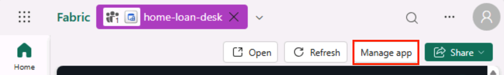

1. In the left navigation, select **Metrics**.

1. In the time range list, select **Last 24 hours**. The default is **Last 30 days**.

1. Confirm that the page shows six cards, each with a summary value for the selected range and a chart of activity over that range.

## Task 2: Read the metrics

Each card answers a different question. Look at each one, and compare it with what you did in the lab.

1. Look at the **Sign ins count** card. It counts sign-in activity, including silent sign-ins, such as when the app reused your session. It doesn't count unique users.

1. Look at the **App loads** card. It counts the loads of the app's **index.html** page. It doesn't count unique visitors, or every file the browser downloads.

1. Look at the **Query count** card. It counts the GraphQL data requests the app processed, including the ones that failed. Notice the activity from the hours when you seeded, browsed, and changed your cases.

1. Look at the **Query error count** and **Query error rate** cards. They count the data requests that failed, and their percentage of all requests.

    <div class="tip" data-title="Tip">

    > A GraphQL response can contain errors even when its HTTP status is **200 OK**. These cards count those failures too, so use them rather than HTTP status codes alone.

    </div>

1. Look at the **Duration - average** card. It shows the average time the server took to process data requests. It isn't the time your browser takes to load or display the app.

1. Notice the time axis of the charts. Charts use UTC time, and **Last 24 hours** ends at the start of the current hour: activity from the last few minutes doesn't show yet.

    <div class="info" data-title="Note">

    > If a card shows **No metric data is available for this time range**, no data was returned for that range. A value of `0` next to this message doesn't confirm that nothing happened. Activity from the first part of the lab is old enough to appear.

    </div>

## Task 3: Know what the metrics don't cover

App Metrics gives you a quick view of your app's health, from the server side. It's important to know its limits before you rely on it.

1. Review what's out of scope for App Metrics:

    | You won't find in App Metrics                                | Where to look instead                     |
    | ------------------------------------------------------------ | ----------------------------------------- |
    | Browser load and rendering times                             | Browser performance tools                 |
    | Individual errors or request traces                          | Your app's own logging                    |
    | Calls to your Microsoft Foundry model, and their token usage | Microsoft Foundry                         |
    | Semantic model query activity                                | The semantic model, in Microsoft Fabric   |
    | Capacity units consumed by the app                           | The Microsoft Fabric Capacity Metrics app |

    <div class="info" data-title="Note">

    > The App Metrics are operational metrics about the app itself. They're unrelated to the portfolio measures from your semantic model, such as **Open applications** or **Stalled applications**.

    </div>

In the next section, you'll check what you've learned about securing and extending the app.

---

# Knowledge check: Securing and extending the app

Before you wrap up, check your understanding of what Rayfin manages, the functions, and the access rules you used to build the Home Loan Operations Desk app.

### Question 1

What does Rayfin manage for your app?

- The semantic model and its measures
- The backend: sign-in, database, storage, functions, and hosting
- Only the frontend hosting
- A separate Azure subscription for the app

<details>
<summary>Show the answer</summary>

**The backend: sign-in, database, storage, functions, and hosting.** Rayfin runs the app's backend in Fabric, so you write entities and rules instead of infrastructure.

</details>

### Question 2

Why call the Foundry model from a Rayfin function?

- The endpoint and API key stay in deployment secrets, out of the browser and source code
- Functions can read cases assigned to any officer
- The browser can't send requests to Microsoft Foundry
- Functions store the generated brief automatically

<details>
<summary>Show the answer</summary>

**The endpoint and API key stay in deployment secrets, out of the browser and source code.** Secrets stay on the server, and case data is read as you, so access rules still apply.

</details>

### Question 3

HL-1103 is in the app's database, but the app won't show it to you. Why?

- The frontend hides cases that aren't assigned to you
- The case wasn't replicated to the app yet
- Only the semantic model can read cases assigned to other officers
- The data API checks the case's access rule against your email on every request

<details>
<summary>Show the answer</summary>

**The data API checks the case's access rule against your email on every request.** Owning the workspace doesn't grant access in the app. The data API enforces access rules on every request.

</details>

In the next section, you'll explore more Rayfin features.

---

# (Optional) Explore more with Rayfin

You've built the Home Loan Operations Desk app end to end. If you have time left, you can pick any of the following tasks to go further. They're independent from each other, and you can do them in any order.

## Task 1: Customize the app

Make the app your own with a small change, and deploy it.

1. In the GitHub Copilot app, open a new session in the **home-loan-desk** project, and make sure it uses **Current checkout**.

1. Enter a prompt describing a small change you'd like, then press **Enter**. For example:

    ```text
    On My cases, add a filter to show only stalled cases, and show the number of open tasks for each case.
    Reuse the existing components and design tokens, and don't change the access rules.
    Then redeploy this app to the same Fabric workspace, without running prior checks or dry run.
    ```

1. Wait for the agent to finish, then reload the deployed app and try your change.

## Task 2: Read portfolio tables directly (Preview)

In Exercise 6, you connected a semantic model to read shared measures. Rayfin connectors can also read tables from Microsoft Fabric SQL sources, such as a lakehouse SQL analytics endpoint, a warehouse, or a SQL database, and expose them in the app as typed entities. A connector reads data where it lives: nothing is copied into the app's own database.

1. In the GitHub Copilot app, open a new session in the **home-loan-desk** project, and make sure it uses **Current checkout**.

1. Switch to **Plan** mode, enter the following prompt, then press **Enter**:

    ```text
    Read directly the Branch table from my CaldovaHomeLoans SQL database that's in my Fabric workspace.
    - Allow only read operations.
    - On the Portfolio page, show the list of branches with their region.
    Then redeploy this app to the same Fabric workspace, without running prior checks or dry run.
    ```

1. Review the plan in the *Plan* and check that it proposes to use a SQL source connector for the Branch table, then select **Approve and implement this plan**.

1. Wait for the agent to finish, then reload the deployed app and select **Portfolio**.

1. Confirm that the five Caldova Home Loans branches are listed with their region.

    <div class="info" data-title="Note">

    > The semantic model connector runs DAX queries over shared measures. SQL source connectors return table rows as typed entities, with their own access rules, which suits reference data like branches.

    </div>

## Task 3: Share a link to a case within Fabric portal (Preview)

Your app runs inside the Microsoft Fabric portal too. With deep linking, the app can store its current view in the portal's URL, so an officer can share a link that reopens the same case. The portal owns the URL, so the app exchanges its state with the Fabric host through the `@microsoft/rayfin-app-state-fabric` package.

1. In the GitHub Copilot app, open a new session in the **home-loan-desk** project, and make sure it uses **Current checkout**.

1. Switch to **Plan** mode, enter the following prompt, then press **Enter**:

    ```text
    I'd like to share links to cases with my colleagues. When the app runs in the Fabric portal, keep the case I'm viewing in the portal's URL, so that the link reopens the same case.
    - The app must keep working the same when it's opened outside of Fabric.
    - Someone opening a link must still sign in, and only see the cases they have access to.
    Then redeploy this app to the same Fabric workspace, without running prior checks or dry run.
    ```

1. Review the plan in the *Plan* canvas and check that it proposes to use Rayfin's Fabric deep linking support, then select **Approve and implement this plan**.

1. Wait for the agent to finish.

1. In the browser, open the Microsoft Fabric tab, go to your `PREL40-homeloans-<your-alias>` workspace, and select the **home-loan-desk** app to run it inside the portal.

1. In the app, open **HL-1042**, then copy the URL from the browser's address bar.

1. Open a new browser tab, paste the URL, then press **Enter**. Confirm that the app opens directly on **HL-1042**.

    <div class="tip" data-title="Tip">

    > A shared link only carries the view, never the data. Whoever opens it still needs access to the app, signs in, and goes through the same access rules: if Morgan opened your link to HL-1042, the app would show that the case isn't available.

    </div>

## Task 4: Build your own app

Go wild and be creative! Start a new Rayfin app from scratch, with the same tools.

1. In the GitHub Copilot app, open a new session.

1. Enter a prompt describing the app you'd like to build, then press **Enter**. For example:

    ```text
    I want to build a Rayfin app for team equipment booking, where signed-in users can book shared equipment, and see only their own bookings. Create a new project for it, and add it to the GitHub Copilot app.
    When it's ready, deploy it to my Fabric workspace.
    ```

1. Wait for the agent to finish, and test your new app once it's deployed.

In the next section, you'll wrap up the lab.

---

# You're done 🎉

Congratulations! In this lab, you built a data-rich app in Microsoft Fabric, from the data to a secured, monitored, AI-assisted app. You:

1. Created and seeded the **CaldovaHomeLoans** SQL database, and checked its OneLake copy through the SQL analytics endpoint.

1. Built a Direct Lake semantic model with relationships, a date table, and shared measures.

1. Bootstrapped and deployed the Home Loan Operations Desk app with Rayfin, using the GitHub Copilot app and the Rayfin plugin.

1. Added portfolio analytics that read the same measures as the semantic model, instead of computing them again in the app.

1. Added property photo uploads, protected by a storage access rule on each case folder.

1. Generated an AI-assisted handoff brief with Microsoft Foundry, from a server-side function that keeps the API key out of the browser.

1. Proved that the app refuses unauthorized access, and reviewed its metrics in Microsoft Fabric.

## Using AI responsibly

The handoff brief was designed to assist a person, not to replace one:

- **A person stays in the loop.** The brief is a draft. Nothing is saved automatically: the loan officer reviews it, then decides to save it as a note labeled **AI-generated**, or to create a task from the suggested next step.
- **Facts come from code, not from the model.** The list of missing documents is computed in code, never by the model. Notes are treated as untrusted content, the model gets no tools, and every note it cites is checked against the notes it received.
- **No lending decisions.** Even when every document is received, the brief suggests the next step, never an approval, a rejection, or a price.

## From lab to production

This lab is a learning scenario, not a production banking reference architecture. Before a similar app goes to production, you'd also need to plan for:

- **A real manager role.** The Portfolio page shows aggregated data to every signed-in user. Seeing all cases or reassigning them requires roles from a trusted source.
- **Cross-record checks.** An access rule checks one record at a time: it can confirm that a note carries your email, but not that its case is assigned to you. Create child records through a server function that checks case ownership first.
- **Keyless AI access.** Call Microsoft Foundry with the app's identity instead of an API key.
- **Row-level security for analytics.** Per-officer analytics require row-level security in the semantic model, which is separate from the app's access rules.
- **Closing the data loop.** Feed the case state from the app back into the analytics snapshot.
- **Document handling.** Add document intelligence, retention policies, malware scanning, and the compliance workflows required for lending.

## Clean up resources

Running this workshop with your own resources may incur costs on your Fabric capacity and Azure subscription. When you're done, remove what you created, as explained in [Clean up](https://github.com/microsoft/ignite26-PREL40/blob/main/docs/setup.md#clean-up) in the setup guide:

- Your `PREL40-homeloans-<your-alias>` workspace in Microsoft Fabric, with its database, semantic model, and app.
- The resource group of your Microsoft Foundry project.
- Your codespace, or the lab folder and skills on your own machine.

## Learn more

- Rayfin documentation: `https://rayfin.ai/docs`
- Fabric apps overview: `https://learn.microsoft.com/fabric/apps/overview`
- Community templates for Rayfin apps: `https://github.com/microsoft/awesome-rayfin`

Thank you for joining this lab! We hope it gave you ideas for your own data-rich apps in Microsoft Fabric.
